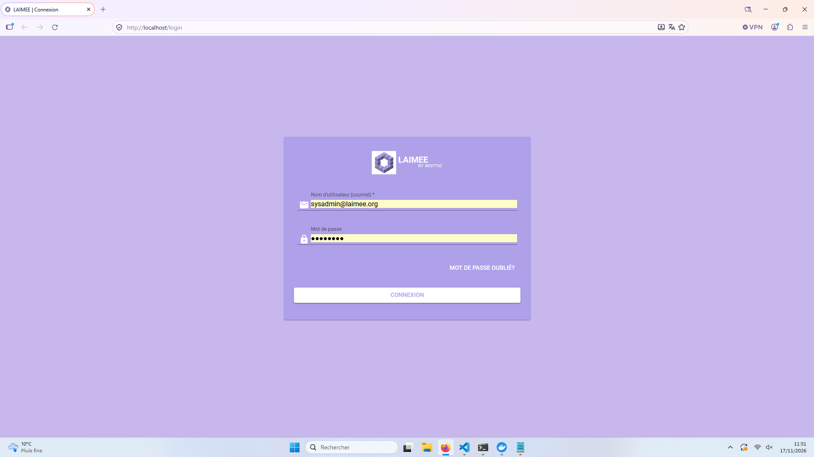
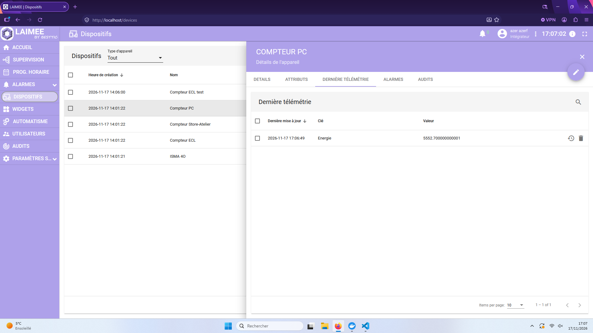
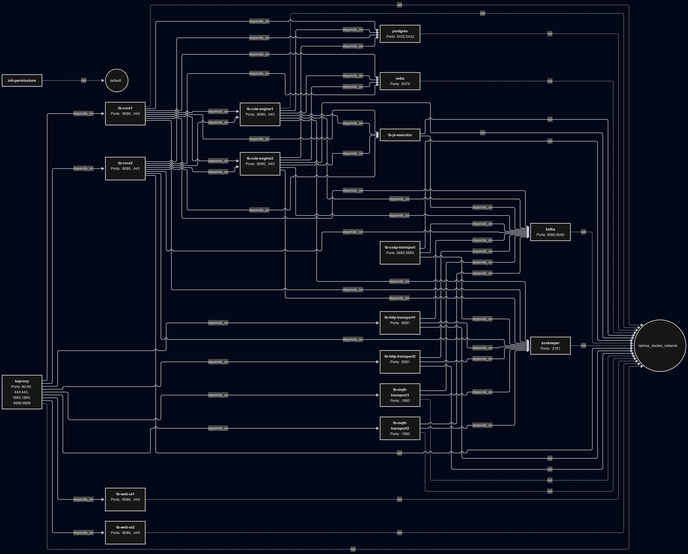
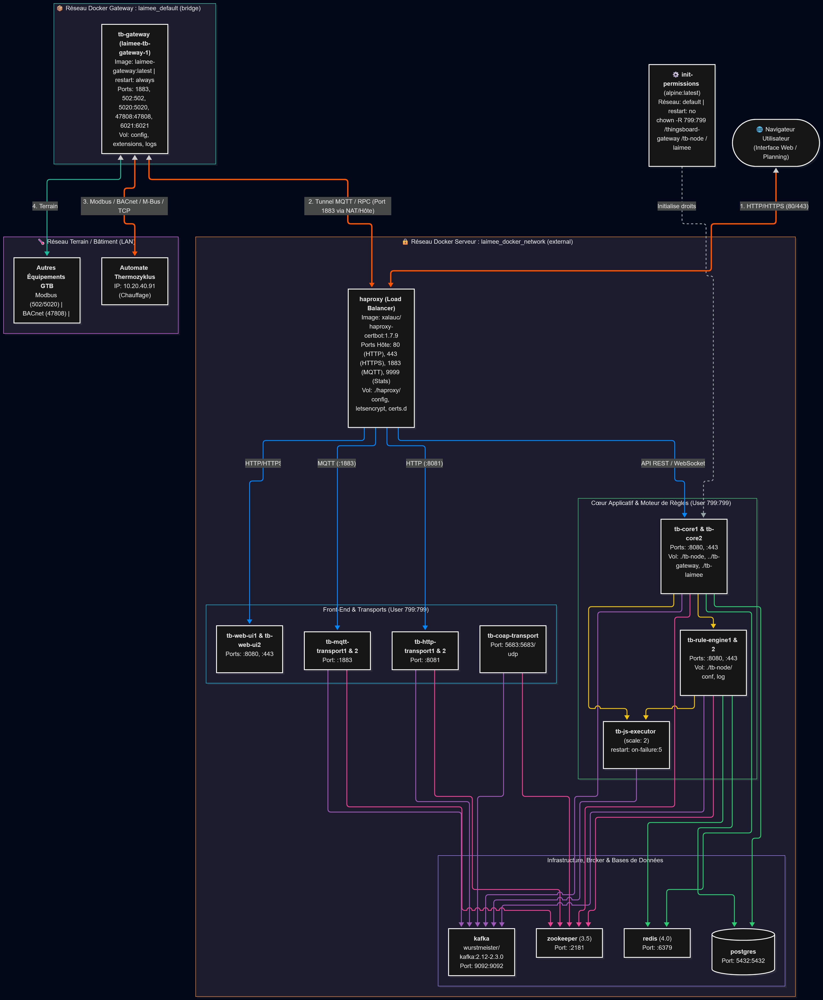

= Documentation technique : Stage Besttic
Melvin
v1.7, 2026-11-17
:toc: left
:toc-title: Sommaire
:docinfo: shared
:toclevels: 4
:sectnums:
:sectnumlevels: 3
:imagesdir: images
:icons: font
:source-highlighter: highlight.js
:copy-to-clipboard:
:autofit-option:

== Mutation des scripts de LAIMEE vers Windows

Cette section présente le script Batch (`installer-windows.bat`) permettant d'automatiser le déploiement complet de l'infrastructure **LAIMEE** sous Windows via Docker Desktop.

IMPORTANT: Assurez-vous que **Docker Desktop** est démarré avant d'exécuter ce script.

=== Étapes réalisées par le script
Le script exécute automatiquement les 7 étapes suivantes :

. Création de l'arborescence locale des dossiers de logs et de configuration.
. Extraction des configurations depuis les images Docker et conversion au format Unix (`LF`).
. Génération dynamique du fichier de routage `haproxy.cfg`.
. Création du réseau Docker dédié (`laimee_docker_network`).
. Chargement des variables d'environnement via `compose-utils.bat`.
. Initialisation de la base de données PostgreSQL (uniquement au premier lancement).
. Démarrage des conteneurs et ouverture automatique de l'interface web.

=== Code source complet

.laimee/installer-windows.bat
[source, dos]
----
@echo off
setlocal enabledelayedexpansion

echo ===================================================
echo   DEMARRAGE AUTOMATIQUE DE LAIMEE SOUS WINDOWS
echo ===================================================

REM 1. Creation des dossiers de logs et de configuration
echo [1/7] Verification des dossiers locaux...
for %%f in (tb-core1 tb-core2 tb-rule-engine1 tb-rule-engine2) do (
    if not exist "tb-node\log\%%f" mkdir "tb-node\log\%%f"
)
for %%d in (
    "tb-node\conf"
    "tb-transports\coap\conf"
    "tb-transports\coap\log\tb-coap-transport"
    "tb-transports\http\conf"
    "tb-transports\http\log\tb-http-transport1"
    "tb-transports\http\log\tb-http-transport2"
    "tb-transports\mqtt\conf"
    "tb-transports\mqtt\log\tb-mqtt-transport1"
    "tb-transports\mqtt\log\tb-mqtt-transport2"
    "haproxy\config"
    "haproxy\letsencrypt"
    "haproxy\certs.d"
    "%USERPROFILE%\.tb-gateway"
    "%USERPROFILE%\.tb-laimee"
) do (
    if not exist %%d mkdir %%d
)

REM 2. Extraction automatique des fichiers conf + correction localhost->postgres (format Unix LF)
if not exist "tb-node\conf\laimee.conf" (
    echo [2/7] Extraction des fichiers de configuration depuis les images Docker...
    docker create --name temp-node laimee/tb-node:latest >nul
    docker cp temp-node:/usr/share/laimee/conf/. tb-node\conf\
    docker rm temp-node >nul

    docker create --name temp-mqtt laimee/tb-mqtt-transport:latest >nul
    docker cp temp-mqtt:/usr/share/tb-mqtt-transport/conf/. tb-transports\mqtt\conf\
    docker rm temp-mqtt >nul

    docker create --name temp-http laimee/tb-http-transport:latest >nul
    docker cp temp-http:/usr/share/tb-http-transport/conf/. tb-transports\http\conf\
    docker rm temp-http >nul

    docker create --name temp-coap laimee/tb-coap-transport:latest >nul
    docker cp temp-coap:/usr/share/tb-coap-transport/conf/. tb-transports\coap\conf\
    docker rm temp-coap >nul
) else (
    echo [2/7] Fichiers de configuration deja presents.
)

REM Nettoyage propre de laimee.conf (format Unix LF sans \r + postgres:5432)
docker run --rm -v "%CD%\tb-node\conf:/conf" postgres:12 sed -i -e "s/\r//g" -e "s/localhost:5432/postgres:5432/g" /conf/laimee.conf

REM 3. Generation automatique de haproxy.cfg (sans check bloquant)
echo [3/7] Configuration de HAProxy...
(
echo global
echo     maxconn 4096
echo.
echo defaults
echo     mode http
echo     timeout connect 5000ms
echo     timeout client 50000ms
echo     timeout server 50000ms
echo.
echo frontend http-in
echo     bind *:80
echo     acl is_api path_beg /api /swagger /webjars /v2/api-docs
echo     acl is_telemetry path_beg /api/v1
echo     use_backend tb_http_backend if is_telemetry
echo     use_backend tb_core_backend if is_api
echo     default_backend tb_web_ui_backend
echo.
echo backend tb_core_backend
echo     balance roundrobin
echo     server tb-core1 tb-core1:8080
echo     server tb-core2 tb-core2:8080
echo.
echo backend tb_http_backend
echo     balance roundrobin
echo     server tb-http1 tb-http-transport1:8081
echo     server tb-http2 tb-http-transport2:8081
echo.
echo backend tb_web_ui_backend
echo     balance roundrobin
echo     server tb-web-ui1 tb-web-ui1:8080
echo     server tb-web-ui2 tb-web-ui2:8080
echo.
echo frontend mqtt-in
echo     bind *:1883
echo     mode tcp
echo     default_backend tb_mqtt_backend
echo.
echo backend tb_mqtt_backend
echo     mode tcp
echo     balance roundrobin
echo     server tb-mqtt1 tb-mqtt-transport1:1883
echo     server tb-mqtt2 tb-mqtt-transport2:1883
) > "haproxy\config\haproxy.cfg"

REM 4. Creation du reseau Docker si inexistant
echo [4/7] Verification du reseau Docker laimee_docker_network...
docker network inspect laimee_docker_network >nul 2>&1
if errorlevel 1 (
    docker network create --driver=bridge --subnet=172.23.0.0/24 --gateway=172.23.0.1 laimee_docker_network >nul
)

REM 5. Lecture des arguments Compose (.env)
call compose-utils.bat :additionalComposeQueueArgs
if errorlevel 1 exit /b %errorlevel%
call compose-utils.bat :additionalComposeArgs
if errorlevel 1 exit /b %errorlevel%
call compose-utils.bat :additionalStartupServices
if errorlevel 1 exit /b %errorlevel%

REM 6. Detection et installation automatique de la base de donnees si vierge
if not exist "tb-node\postgres\PG_VERSION" (
    echo [5/7] Base de donnees vierge detectee : installation des tables SQL en cours...
    docker compose -p laimee -f docker-compose.yml %ADDITIONAL_COMPOSE_ARGS% %ADDITIONAL_COMPOSE_QUEUE_ARGS% up -d redis %ADDITIONAL_STARTUP_SERVICES%
    timeout /t 5 /nobreak >nul
    docker compose -p laimee -f docker-compose.yml %ADDITIONAL_COMPOSE_ARGS% %ADDITIONAL_COMPOSE_QUEUE_ARGS% run --no-deps --rm -e INSTALL_TB=true -e LOAD_DEMO=false -e INSTALL_DATA_DIR=/usr/share/laimee/data tb-core1
    if errorlevel 1 (
        echo Erreur lors de l'initialisation de la base de donnees.
        pause
        exit /b 1
    )
) else (
    echo [5/7] Base de donnees deja initialisee.
)

REM 7. Demarrage complet de tous les services et synchronisation HAProxy
echo [6/7] Demarrage de tous les conteneurs...
docker compose -p laimee -f docker-compose.yml %ADDITIONAL_COMPOSE_ARGS% %ADDITIONAL_COMPOSE_QUEUE_ARGS% up -d
if errorlevel 1 exit /b %errorlevel%

echo [7/7] Attente que le serveur backend soit operationnel (cette etape prend environ 3 a 5 minutes)...
set /a elapsed=0
:wait_backend
timeout /t 30 /nobreak >nul
set /a elapsed+=30
set /a mins=elapsed / 60
set /a secs=elapsed %% 60
if !secs! lss 10 set "secs=0!secs!"
docker exec laimee-tb-core1-1 bash -c "echo > /dev/tcp/localhost/8080" >nul 2>&1
if errorlevel 1 (
    echo   [!mins!m !secs!s] Demarrage des services Java en cours, merci de patienter...
    goto :wait_backend
)

echo   Serveur operationnel ! Synchronisation de HAProxy...
docker restart haproxy-certbot >nul 2>&1
timeout /t 3 /nobreak >nul
start http://localhost

echo.
echo ===================================================
echo   TOUT EST PRET !
echo   Interface Web : http://localhost
echo   Identifiant   : sysadmin@laimee.org
echo   Mot de passe  : sysadmin
echo ===================================================
echo.
----

TIP: À la fin de l'exécution, l'interface web s'ouvre automatiquement à l'adresse `http://localhost` avec les identifiants par défaut.

=== Mécanisme d'attente et détection du démarrage du backend

Le démarrage des microservices Java de ThingsBoard (`tb-core1`) prend généralement entre **3 et 5 minutes**. Si le navigateur ou HAProxy tente d'accéder à l'interface avant la fin de cette initialisation, une erreur `503 Service Unavailable` s'affiche.

Pour éviter ce problème, l'étape `[7/7]` du script met en place une **boucle de surveillance active** :

.Extrait de la boucle d'attente (installer-windows.bat)
[source, dos]
----
echo [7/7] Attente que le serveur backend soit operationnel (cette etape prend environ 3 a 5 minutes)...
set /a elapsed=0
:wait_backend
timeout /t 30 /nobreak >nul
set /a elapsed+=30
set /a mins=elapsed / 60
set /a secs=elapsed %% 60
if !secs! lss 10 set "secs=0!secs!"
docker exec laimee-tb-core1-1 bash -c "echo > /dev/tcp/localhost/8080" >nul 2>&1
if errorlevel 1 (
    echo   [!mins!m !secs!s] Demarrage des services Java en cours, merci de patienter...
    goto :wait_backend
)
----

==== Fonctionnement détaillé

* **Temporisation (`timeout /t 30 /nobreak`)** : Le script marque une pause de 30 secondes à chaque cycle sans pouvoir être interrompu par une touche accidentelle.
* **Chronomètre dynamique (`!mins!m !secs!s`)** : À chaque tour de boucle, la variable `elapsed` est incrémentée de 30 secondes. Le script convertit ce total en minutes (`elapsed / 60`) et secondes (`elapsed %% 60`), en ajoutant un zéro devant les secondes inférieures à 10 (`if !secs! lss 10`) pour un affichage propre (ex. `01m 30s`).
* **Sonde TCP interne (`docker exec ... /dev/tcp/localhost/8080`)** : Le script exécute un test de connexion TCP directement à l'intérieur du conteneur `laimee-tb-core1-1` sur le port `8080`.
* **Condition de sortie (`if errorlevel 1`)** :
  * Tant que le port `8080` est fermé, la commande renvoie un code d'erreur (`1`), le message de progression s'affiche et le script reboucle sur l'étiquette `:wait_backend`.
  * Dès que le serveur Java ouvre le port `8080`, la commande réussit (`errorlevel 0`), ce qui libère le script pour redémarrer **HAProxy** et ouvrir automatiquement `http://localhost`.

TIP: Si l'image Docker utilisée ne dispose pas de `bash` (cas des images minimales sous `/bin/sh`), la sonde `/dev/tcp` peut être remplacée par une lecture directe de la table réseau du noyau Linux : `docker exec laimee-tb-core1-1 grep -qi ":1F90" /proc/net/tcp /proc/net/tcp6` (où `1F90` correspond au port `8080` en hexadécimal).

=== Résultat de l'execution du script dans le terminal

[source, powershell]
----
PS C:\Users\Dev-Sta-1\Documents\Melvin\laimee> .\installer-windows.bat
===================================================
  DEMARRAGE AUTOMATIQUE DE LAIMEE SOUS WINDOWS
===================================================
[1/7] Verification des dossiers locaux...
[2/7] Extraction des fichiers de configuration depuis les images Docker...
Successfully copied 175kB to C:\Users\Dev-Sta-1\Documents\Melvin\laimee\tb-node\conf\
Successfully copied 23.6kB to C:\Users\Dev-Sta-1\Documents\Melvin\laimee\tb-transports\mqtt\conf\
Successfully copied 22kB to C:\Users\Dev-Sta-1\Documents\Melvin\laimee\tb-transports\http\conf\
Successfully copied 22.5kB to C:\Users\Dev-Sta-1\Documents\Melvin\laimee\tb-transports\coap\conf\
[3/7] Configuration de HAProxy...
[4/7] Verification du reseau Docker laimee_docker_network...
[5/7] Base de donnees vierge detectee : installation des tables SQL en cours...
[+] up 2/2
 ✔ Container laimee-redis-1    Started                       0.5s
 ✔ Container laimee-postgres-1 Started                       0.8s
[+] run 1/1
 ✔ Container laimee-tb-core1-run-63cf0c987e9a Created        0.1s
TB-NODE
Starting Laimee installation ...
OpenJDK 64-Bit Server VM warning: Option UseConcMarkSweepGC was deprecated in version 9.0 and will likely be removed in a future release.
11:21:44,572 |-INFO in ch.qos.logback.classic.LoggerContext[default] - Could NOT find resource [logback-test.xml]
11:21:44,576 |-INFO in ch.qos.logback.classic.LoggerContext[default] - Could NOT find resource [logback.groovy]
11:21:44,582 |-INFO in ch.qos.logback.classic.LoggerContext[default] - Found resource [logback.xml] at [file:/config/logback.xml]
11:21:44,594 |-WARN in ch.qos.logback.classic.LoggerContext[default] - Resource [logback.xml] occurs multiple times on the classpath.
11:21:44,594 |-WARN in ch.qos.logback.classic.LoggerContext[default] - Resource [logback.xml] occurs at [file:/usr/share/laimee/conf/logback.xml]
11:21:44,594 |-WARN in ch.qos.logback.classic.LoggerContext[default] - Resource [logback.xml] occurs at [file:/config/logback.xml]
11:21:45,136 |-INFO in ch.qos.logback.classic.joran.action.ConfigurationAction - debug attribute not set
11:21:45,204 |-INFO in ch.qos.logback.classic.joran.action.ConfigurationAction - Will scan for changes in [file:/config/logback.xml]
11:21:45,204 |-INFO in ch.qos.logback.classic.joran.action.ConfigurationAction - Setting ReconfigureOnChangeTask scanning period to 10 seconds
11:21:45,223 |-INFO in ch.qos.logback.core.joran.action.AppenderAction - About to instantiate appender of type [ch.qos.logback.core.rolling.RollingFileAppender]
11:21:45,247 |-INFO in ch.qos.logback.core.joran.action.AppenderAction - Naming appender as [fileLogAppender]
11:21:45,307 |-INFO in c.q.l.core.rolling.SizeAndTimeBasedRollingPolicy@1967892594 - setting totalSizeCap to 3 GB
11:21:45,323 |-INFO in c.q.l.core.rolling.SizeAndTimeBasedRollingPolicy@1967892594 - Archive files will be limited to [100 MB] each.
11:21:45,442 |-INFO in c.q.l.core.rolling.SizeAndTimeBasedRollingPolicy@1967892594 - No compression will be used
11:21:45,450 |-INFO in c.q.l.core.rolling.SizeAndTimeBasedRollingPolicy@1967892594 - Will use the pattern /var/log/laimee/laimee.%d{yyyy-MM-dd}.%i.log for the active file
11:21:45,457 |-INFO in ch.qos.logback.core.rolling.SizeAndTimeBasedFNATP@146ba0ac - The date pattern is 'yyyy-MM-dd' from file name pattern '/var/log/laimee/laimee.%d{yyyy-MM-dd}.%i.log'.
11:21:45,457 |-INFO in ch.qos.logback.core.rolling.SizeAndTimeBasedFNATP@146ba0ac - Roll-over at midnight.
11:21:45,474 |-INFO in ch.qos.logback.core.rolling.SizeAndTimeBasedFNATP@146ba0ac - Setting initial period to Tue Nov 17 11:21:45 CET 2026
11:21:45,485 |-INFO in ch.qos.logback.core.joran.action.NestedComplexPropertyIA - Assuming default type [ch.qos.logback.classic.encoder.PatternLayoutEncoder] for [encoder] property
11:21:45,560 |-INFO in ch.qos.logback.core.rolling.RollingFileAppender[fileLogAppender] - Active log file name: /var/log/laimee/laimee.log
11:21:45,560 |-INFO in ch.qos.logback.core.rolling.RollingFileAppender[fileLogAppender] - File property is set to [/var/log/laimee/laimee.log]
11:21:45,567 |-INFO in ch.qos.logback.classic.joran.action.LoggerAction - Setting level of logger [org.thingsboard.server] to INFO
11:21:45,567 |-INFO in ch.qos.logback.classic.joran.action.LoggerAction - Setting level of logger [com.microsoft.azure.servicebus.primitives.CoreMessageReceiver] to OFF
11:21:45,567 |-INFO in ch.qos.logback.classic.joran.action.RootLoggerAction - Setting level of ROOT logger to INFO
11:21:45,567 |-INFO in ch.qos.logback.core.joran.action.AppenderRefAction - Attaching appender named [fileLogAppender] to Logger[ROOT]
11:21:45,569 |-INFO in ch.qos.logback.classic.joran.action.ConfigurationAction - End of configuration.
11:21:45,571 |-INFO in ch.qos.logback.classic.joran.JoranConfigurator@4dfa3a9d - Registering current configuration as safe fallback point

WARNING: An illegal reflective access operation has occurred
WARNING: Illegal reflective access by org.codehaus.groovy.vmplugin.v7.Java7$1 (jar:file:/usr/share/laimee/bin/laimee.jar!/BOOT-INF/lib/groovy-2.5.7-indy.jar!/) to constructor java.lang.invoke.MethodHandles$Lookup(java.lang.Class,int)
WARNING: Please consider reporting this to the maintainers of org.codehaus.groovy.vmplugin.v7.Java7$1
WARNING: Use --illegal-access=warn to enable warnings of further illegal reflective access operations
WARNING: All illegal access operations will be denied in a future release
 ===================================================
 :: Laimee ::       (v3.1.1-SNAPSHOT)
 ===================================================

Starting Laimee Installation...
Installing DataBase schema for entities...
Installing SQL DataBase schema part: schema-entities.sql
Installing SQL DataBase schema indexes part: schema-entities-idx.sql
Installing DataBase schema for timeseries...
Installing SQL DataBase schema part: schema-ts-psql.sql
Successfully executed query: CREATE TABLE IF NOT EXISTS ts_kv_indefinite PARTITION OF ts_kv DEFAULT;
Loading system data...
Installation finished successfully!
[6/7] Demarrage de tous les conteneurs...
[+] up 19/19
 ✔ Container laimee-postgres-1                 Running             0.0s
 ✔ Container laimee-redis-1                    Running             0.0s
 ✔ Container laimee-init-permissions-1         Started             3.1s
 ✔ Container laimee-tb-web-ui2-1               Started             4.3s
 ✔ Container laimee-zookeeper-1                Started             5.0s
 ✔ Container laimee-kafka-1                    Started             5.5s
 ✔ Container laimee-tb-web-ui1-1               Started             3.7s
 ✔ Container laimee-tb-js-executor-1           Started             5.6s
 ✔ Container laimee-tb-js-executor-2           Started             6.4s
 ✔ Container laimee-tb-http-transport1-1       Started             9.3s
 ✔ Container laimee-tb-http-transport2-1       Started             8.5s
 ✔ Container laimee-tb-mqtt-transport1-1       Started             7.8s
 ✔ Container laimee-tb-mqtt-transport2-1       Started             6.9s
 ✔ Container laimee-tb-coap-transport-1        Started            10.2s
 ✔ Container laimee-tb-rule-engine1-1          Started            10.7s
 ✔ Container laimee-tb-rule-engine2-1          Started            11.4s
 ✔ Container laimee-tb-core2-1                 Started            11.8s
 ✔ Container laimee-tb-core1-1                 Started            13.7s
 ✔ Container haproxy-certbot                   Started            17.2s
[7/7] Attente que le serveur backend soit operationnel (cette etape prend environ 3 a 5 minutes)...
  [0m 30s] Demarrage des services Java en cours, merci de patienter...
  [1m 00s] Demarrage des services Java en cours, merci de patienter...
  [1m 30s] Demarrage des services Java en cours, merci de patienter...
  [2m 00s] Demarrage des services Java en cours, merci de patienter...
  [2m 30s] Demarrage des services Java en cours, merci de patienter...
  [3m 00s] Demarrage des services Java en cours, merci de patienter...
  [3m 30s] Demarrage des services Java en cours, merci de patienter...
  [4m 00s] Demarrage des services Java en cours, merci de patienter...
  Serveur operationnel  Synchronisation de HAProxy...

===================================================
  TOUT EST PRET
  Interface Web : http://localhost
  Identifiant   : sysadmin@laimee.org
  Mot de passe  : sysadmin
===================================================
----

==== Docker compose 

===== docker-compose.yml
[source, yaml]
----
services:
  # --- NOUVEAU SERVICE À AJOUTER ---
  init-permissions:
    image: alpine:latest
    user: "0:0"
    volumes:
      - ../tb-gateway:/thingsboard-gateway:rw
      - ./tb-node:/tb-node:rw
      - ./tb-laimee:/laimee:rw
    command: >
      sh -c "chown -R 799:799 /thingsboard-gateway /tb-node /laimee &&
             chmod -R 775 /thingsboard-gateway"
    restart: "no"  
  # --- SERCIVE PAR DEFAUT ---
  zookeeper:
    restart: always
    image: "zookeeper:3.5"
    networks:
      - laimee_docker_network
    pull_policy: missing
    ports:
      - "2181"
    environment:
      ZOO_MY_ID: 1
      ZOO_SERVERS: server.1=zookeeper:2888:3888;zookeeper:2181
      TZ: "${TIME_ZONE}"

  redis:
    restart: always
    image: "redis:4.0"
    networks:
      - laimee_docker_network
    pull_policy: missing
    ports:
      - "6379"
    environment:
      TZ: "${TIME_ZONE}"

  tb-js-executor:
    #restart: always
    #restart: no
    restart: on-failure:5
    image: "${DOCKER_REPO}/${JS_EXECUTOR_DOCKER_NAME}:${TB_VERSION}"
    networks:
      - laimee_docker_network
    pull_policy: missing
    #nb of containers
    #scale: 20
    scale: 2
    env_file:
      - tb-js-executor.env
    environment:
      TZ: "${TIME_ZONE}"

  tb-core1:
    restart: always
    image: "${DOCKER_REPO}/${TB_NODE_DOCKER_NAME}:${TB_VERSION}"
    networks:
      - laimee_docker_network
    pull_policy: missing
    ports:
      - "8080"
      - "443"
    logging:
      driver: "json-file"
      options:
        max-size: "200m"
        max-file: "30"
    environment:
      TB_SERVICE_ID: tb-core1
      TB_SERVICE_TYPE: tb-core
      TZ: "${TIME_ZONE}"
    env_file:
      - tb-node.env
    volumes:
      - ./tb-node/conf:/config
      - ./tb-node/log:/var/log/laimee
      - ../tb-gateway:/thingsboard-gateway:rw
      #- ~/.etc-laimee:/etc/laimee
      - ./tb-laimee:/laimee:rw
    user: "799:799"
    depends_on:
      - zookeeper
      - redis
      - tb-js-executor
      - tb-rule-engine1
      - tb-rule-engine2

  tb-core2:
    restart: always
    image: "${DOCKER_REPO}/${TB_NODE_DOCKER_NAME}:${TB_VERSION}"
    networks:
      - laimee_docker_network
    pull_policy: missing
    ports:
      - "8080"
      - "443"
    logging:
      driver: "json-file"
      options:
        max-size: "200m"
        max-file: "30"
    environment:
      TB_SERVICE_ID: tb-core2
      TB_SERVICE_TYPE: tb-core
      TZ: "${TIME_ZONE}"
    env_file:
      - tb-node.env
    volumes:
      - ./tb-node/conf:/config
      - ./tb-node/log:/var/log/laimee
      - ../tb-gateway:/thingsboard-gateway:rw
      #- ~/.etc-laimee:/etc/laimee
      - ./tb-laimee:/laimee:rw
    user: "799:799"
    depends_on:
      - zookeeper
      - redis
      - tb-js-executor
      - tb-rule-engine1
      - tb-rule-engine2
  
  tb-rule-engine1:
    restart: always
    image: "${DOCKER_REPO}/${TB_NODE_DOCKER_NAME}:${TB_VERSION}"
    networks:
      - laimee_docker_network
    pull_policy: missing
    ports:
      - "8080"
      - "443"
    logging:
      driver: "json-file"
      options:
        max-size: "200m"
        max-file: "30"
    environment:
      TB_SERVICE_ID: tb-rule-engine1
      TB_SERVICE_TYPE: tb-rule-engine
      TZ: "${TIME_ZONE}"
    env_file:
      - tb-node.env
    volumes:
      - ./tb-node/conf:/config
      - ./tb-node/log:/var/log/laimee
    user: "799:799"
    depends_on:
      - zookeeper
      - redis
      - tb-js-executor
  
  tb-rule-engine2:
    restart: always
    image: "${DOCKER_REPO}/${TB_NODE_DOCKER_NAME}:${TB_VERSION}"
    networks:
      - laimee_docker_network
    pull_policy: missing
    ports:
      - "8080"
      - "443"
    logging:
      driver: "json-file"
      options:
        max-size: "200m"
        max-file: "30"
    environment:
      TB_SERVICE_ID: tb-rule-engine2
      TB_SERVICE_TYPE: tb-rule-engine
      TZ: "${TIME_ZONE}"
    env_file:
      - tb-node.env
    volumes:
      - ./tb-node/conf:/config
      - ./tb-node/log:/var/log/laimee
    user: "799:799"
    depends_on:
      - zookeeper
      - redis
      - tb-js-executor
  
  tb-mqtt-transport1:
    restart: always
    image: "${DOCKER_REPO}/${MQTT_TRANSPORT_DOCKER_NAME}:${TB_VERSION}"
    networks:
      - laimee_docker_network
    pull_policy: missing
    ports:
      - "1883"
    environment:
      TB_SERVICE_ID: tb-mqtt-transport1
      TZ: "${TIME_ZONE}"
    env_file:
      - tb-mqtt-transport.env
    volumes:
      - ./tb-transports/mqtt/conf:/config
      - ./tb-transports/mqtt/log:/var/log/tb-mqtt-transport
    user: "799:799"
    depends_on:
      - zookeeper
  
  tb-mqtt-transport2:
    restart: always
    image: "${DOCKER_REPO}/${MQTT_TRANSPORT_DOCKER_NAME}:${TB_VERSION}"
    networks:
      - laimee_docker_network
    pull_policy: missing
    ports:
      - "1883"
    environment:
      TB_SERVICE_ID: tb-mqtt-transport2
      TZ: "${TIME_ZONE}"
    env_file:
      - tb-mqtt-transport.env
    volumes:
      - ./tb-transports/mqtt/conf:/config
      - ./tb-transports/mqtt/log:/var/log/tb-mqtt-transport
    user: "799:799"
    depends_on:
      - zookeeper
  
  tb-http-transport1:
    restart: always
    image: "${DOCKER_REPO}/${HTTP_TRANSPORT_DOCKER_NAME}:${TB_VERSION}"
    networks:
      - laimee_docker_network
    pull_policy: missing
    ports:
      - "8081"
    environment:
      TB_SERVICE_ID: tb-http-transport1
      TZ: "${TIME_ZONE}"
    env_file:
      - tb-http-transport.env
    volumes:
      - ./tb-transports/http/conf:/config
      - ./tb-transports/http/log:/var/log/tb-http-transport
    user: "799:799"
    depends_on:
      - zookeeper
  
  tb-http-transport2:
    restart: always
    image: "${DOCKER_REPO}/${HTTP_TRANSPORT_DOCKER_NAME}:${TB_VERSION}"
    networks:
      - laimee_docker_network
    pull_policy: missing
    ports:
      - "8081"
    environment:
      TB_SERVICE_ID: tb-http-transport2
      TZ: "${TIME_ZONE}"
    env_file:
      - tb-http-transport.env
    volumes:
      - ./tb-transports/http/conf:/config
      - ./tb-transports/http/log:/var/log/tb-http-transport
    user: "799:799"
    depends_on:
      - zookeeper
  
  tb-coap-transport:
    restart: always
    image: "${DOCKER_REPO}/${COAP_TRANSPORT_DOCKER_NAME}:${TB_VERSION}"
    networks:
      - laimee_docker_network
    pull_policy: missing
    ports:
      - "5683:5683/udp"
    environment:
      TB_SERVICE_ID: tb-coap-transport
      TZ: "${TIME_ZONE}"
    env_file:
      - tb-coap-transport.env
    volumes:
      - ./tb-transports/coap/conf:/config
      - ./tb-transports/coap/log:/var/log/tb-coap-transport
    user: "799:799"
    depends_on:
      - zookeeper
 
  tb-web-ui1:
    restart: always
    image: "${DOCKER_REPO}/${WEB_UI_DOCKER_NAME}:${TB_VERSION}"
    networks:
      - laimee_docker_network
    pull_policy: missing
    ports:
      - "8080"
      - "443"
    env_file:
      - tb-web-ui.env
    environment:
      TZ: "${TIME_ZONE}"
 
  tb-web-ui2:
    restart: always
    image: "${DOCKER_REPO}/${WEB_UI_DOCKER_NAME}:${TB_VERSION}"
    networks:
      - laimee_docker_network
    pull_policy: missing
    ports:
      - "8080"
      - "443"
    env_file:
      - tb-web-ui.env
    environment:
      TZ: "${TIME_ZONE}"

  haproxy:
    restart: always
    container_name: "${LOAD_BALANCER_NAME}"
    image: "xalauc/haproxy-certbot:1.7.9"
    networks:
      - laimee_docker_network
    pull_policy: missing
    volumes:
     - ./haproxy/config:/config
     - ./haproxy/letsencrypt:/etc/letsencrypt
     - ./haproxy/certs.d:/usr/local/etc/haproxy/certs.d
    ports:
     - "80:80"
     - "443:443"
     - "1883:1883"
     - "9999:9999"
    cap_add:
     - NET_ADMIN
    environment:
      HTTP_PORT: 80
      HTTPS_PORT: 443
      MQTT_PORT: 1883
      FORCE_HTTPS_REDIRECT: "false"
      TZ: "${TIME_ZONE}"
    links:
        - tb-core1
        - tb-core2
        - tb-web-ui1
        - tb-web-ui2
        - tb-mqtt-transport1
        - tb-mqtt-transport2
        - tb-http-transport1
        - tb-http-transport2

networks:
  laimee_docker_network:
    name: laimee_docker_network
    external: true

----

===== docker-compose.kafka.yml
[source, yaml]
----
services:
  kafka:
    #restart: always
    restart: always
    image: "wurstmeister/kafka:2.12-2.3.0"
    networks:
      - laimee_docker_network
    pull_policy: missing
    ports:
      - "9092:9092"
    env_file:
      - kafka.env

    # ADD

    # healthcheck: # test du port 2181 de zookeeper
    #   test: ["CMD-SHELL", "echo ruok | nc -w 2 localhost 2181 | grep imok"]
    #   interval: 2s
    #   timeout: 2s
    #   retries: 10
    
    # depends_on:
    #     zookeeper:
    #       condition: service_healthy # attendre le demarrage complet du docker
      
    # END

    environment:
        TZ: "${TIME_ZONE}"

  tb-js-executor:
    env_file:
      - queue-kafka.env
    depends_on:
      - kafka
  tb-core1:
    env_file:
      - queue-kafka.env
    depends_on:
      - kafka
      - redis
  tb-core2:
    env_file:
      - queue-kafka.env
    depends_on:
      - kafka
      - redis
  tb-rule-engine1:
    env_file:
      - queue-kafka.env
    depends_on:
      - kafka
      - redis
  tb-rule-engine2:
    env_file:
      - queue-kafka.env
    depends_on:
      - kafka
      - redis
  tb-mqtt-transport1:
    env_file:
      - queue-kafka.env
    depends_on:
      - kafka
  tb-mqtt-transport2:
    env_file:
      - queue-kafka.env
    depends_on:
      - kafka
  tb-http-transport1:
    env_file:
      - queue-kafka.env
    depends_on:
      - kafka
  tb-http-transport2:
    env_file:
      - queue-kafka.env
    depends_on:
      - kafka
  tb-coap-transport:
    env_file:
      - queue-kafka.env
    depends_on:
      - kafka

networks:
  laimee_docker_network:
    name: laimee_docker_network
    external: true
----

=== Interface web fonctionnelle

La capture d'écran ci-dessous montre l'affichage complet de l'interface web de la plateforme. Cela confirme que l'ensemble des conteneurs Docker fonctionnent et communiquent correctement entre eux. De plus, l'accès direct via le port `80` valide le bon routage des requêtes par le répartiteur de charge **HAProxy**.

.Interface web de la plateforme LAIMEE accessible sur le port 80

== Mutation des scripts de la passerelle vers Windows

Cette section présente le script Batch (`installer-windows.bat`) permettant d'automatiser la construction de l'image Docker et le démarrage de la passerelle **LAIMEE Gateway** sous Windows.

IMPORTANT: Ce script doit être exécuté depuis le sous-dossier `gateway` de votre projet afin de localiser correctement le dossier source `thingsboard_gateway` et le répertoire parent `../tb-gateway`.

=== Étapes réalisées par le script

Le script exécute automatiquement les 6 étapes suivantes :

. Recherche automatique du répertoire source `thingsboard_gateway` dans l'arborescence parente.
. Copie du code source Python en local et attribution des permissions Windows complètes (`icacls`) pour éviter les blocages de lecture dans Docker.
. Construction de l'image Docker locale (`laimee-gateway:latest`) sans cache (`--no-cache`).
. Lecture et chargement des variables d'environnement depuis le fichier `.env`.
. Création des dossiers de volumes persistants (`config`, `extensions`, `logs`) dans `../tb-gateway` avec ouverture des droits d'accès.
. Lancement et recréation forcée du conteneur via Docker Compose sous le projet `laimee`.

=== Code source complet

.gateway/installer-windows.bat
[source, dos]
----
@echo off
setlocal enabledelayedexpansion

echo ============================================================================
echo        DEPLOIEMENT ET DEMARRAGE DE LAIMEE GATEWAY (DOCKER WINDOWS)
echo ============================================================================
echo.

REM --- ETAPE 1 : RECHERCHE DU CODE SOURCE ---
echo [1/6] Recherche du dossier source thingsboard_gateway...
set "CURR_DIR=%CD%"
set "SRC_DIR="

pushd ..
for /f "delims=" %%D in ('dir /s /b /ad thingsboard_gateway 2^>nul') do (
    if /I not "%%~fD"=="%CURR_DIR%\thingsboard_gateway" (
        set "SRC_DIR=%%~fD"
        goto :found_src
    )
)

:found_src
popd

if not "%SRC_DIR%"=="" (
    echo       Source externe trouvee : "%SRC_DIR%"
    echo [2/6] Copie du code source Python vers le dossier Docker local...
    if exist "thingsboard_gateway" (
        rmdir /s /q "thingsboard_gateway"
    )
    xcopy /E /I /Y /Q "%SRC_DIR%" ".\thingsboard_gateway" >nul
    if !ERRORLEVEL! NEQ 0 (
        echo [ERREUR] Echec lors de la copie du dossier thingsboard_gateway.
        pause
        exit /b !ERRORLEVEL!
    )
    echo       Copie terminee avec succes.
) else if exist ".\thingsboard_gateway" (
    echo       Dossier thingsboard_gateway deja present sur place.
    echo [2/6] Copie ignoree.
) else (
    echo [ERREUR] Dossier thingsboard_gateway introuvable.
    pause
    exit /b 1
)

echo       Application des droits d'acces Windows...
icacls ".\thingsboard_gateway" /grant *S-1-1-0:(OI)(CI)F /T /Q >nul
echo.

REM --- ETAPE 2 : CONSTRUCTION DE L'IMAGE DOCKER ---
echo [3/6] Construction de l'image Docker (laimee-gateway:latest) sans cache...
docker build --no-cache -t laimee-gateway:latest .
if %ERRORLEVEL% NEQ 0 (
    echo [ERREUR] Echec lors du build de l'image Docker.
    pause
    exit /b %ERRORLEVEL%
)
echo       Image Docker construite avec succes.
echo.

REM --- ETAPE 3 : CHARGEMENT DE LA CONFIGURATION (.ENV) ---
echo [4/6] Chargement des variables d'environnement (.env)...
if exist .env (
    for /f "usebackq tokens=1,* delims==" %%a in (".env") do (
        set "line=%%a"
        if not "!line:~0,1!"=="#" (
            set "%%a=%%b"
            echo       Variable chargee : %%a
        )
    )
) else (
    echo       Aucun fichier .env trouve, valeurs par defaut utilisees.
)
echo.

REM --- ETAPE 4 : PREPARATION DES VOLUMES PERSISTANTS ---
echo [5/6] Preparation des dossiers dans ../tb-gateway...
set "TB_DIR=%../tb-gateway"
if not exist "%TB_DIR%\config" mkdir "%TB_DIR%\config"
if not exist "%TB_DIR%\extensions" mkdir "%TB_DIR%\extensions"
if not exist "%TB_DIR%\logs" mkdir "%TB_DIR%\logs"
icacls "%TB_DIR%" /grant *S-1-1-0:(OI)(CI)F /T /Q >nul
echo       Dossiers prets.
echo.

REM --- ETAPE 5 : DEMARRAGE DU CONTENEUR ---
echo [6/6] Demarrage du conteneur via Docker Compose...
docker compose -p laimee -f docker-compose.yml up -d --force-recreate
if %ERRORLEVEL% NEQ 0 (
    echo [ERREUR] Echec lors du demarrage avec Docker Compose.
    pause
    exit /b %ERRORLEVEL%
)

echo.
echo ============================================================================
echo        SUCCES : LAIMEE GATEWAY EST EN COURS D'EXECUTION
echo ============================================================================
pause
----

NOTE: L'utilisation de la commande `icacls ... /grant *S-1-1-0:(OI)(CI)F` accorde un contrôle total universel (SID `Everyone`), ce qui résout définitivement les erreurs `Permission denied` lors du montage des volumes entre Windows et Linux.

=== Résultat de l'execution du script dans le terminal
[source, powershell]
----
PS C:\Users\Dev-Sta-1\Documents\Melvin\gateway> .\installer.bat
WARN[0000] Found orphan containers (haproxy-certbot, laimee-tb-core1-1, laimee-tb-core2-1, laimee-tb-rule-engine2-1, laimee-tb-rule-engine1-1, laimee-tb-http-transport2-1, laimee-tb-http-transport1-1, laimee-tb-mqtt-transport2-1, laimee-tb-coap-transport-1, laimee-tb-mqtt-transport1-1, laimee-tb-js-executor-2, laimee-tb-js-executor-1, laimee-postgres-1, laimee-init-permissions-1, laimee-redis-1, laimee-tb-web-ui2-1, laimee-zookeeper-1, laimee-kafka-1, laimee-tb-web-ui1-1) for this project. If you removed or renamed this service in your compose file, you can run this command with the --remove-orphans flag to clean it up.
[+] up 1/1
 ✔ Container laimee-tb-gateway-1            Started             1.6s
Conteneurs laimee demarres avec succes.
Appuyez sur une touche pour continuer...
PS C:\Users\Dev-Sta-1\Documents\Melvin\gateway>
----

==== Docker compose

===== docker-compose.yml

[source, yaml]
----
services:
  tb-gateway:
    restart: always
    image: "laimee-gateway:latest"
    networks:
      - laimee_default
    ports:
      - "1883"        # MQTT
      - "502:502"     # Modbus
      - "5020:5020"
      - "47808:47808" # BACnet
      - "6021:6021"   # Mbus
    volumes:
      - ../tb-gateway/config:/thingsboard_gateway/config
      - ../tb-gateway/extensions:/thingsboard_gateway/extensions
      - ../tb-gateway/logs:/thingsboard_gateway/logs

networks:
  laimee_default:
    driver: bridge
----

==== Résultat sur l'interface web

La capture d'écran ci-dessous confirme que les données de télémétrie remontent correctement jusqu'au serveur web. Cela valide le bon fonctionnement de la connexion et des échanges entre la plateforme **LAIMEE** et la passerelle (**LAIMEE Gateway**).

.Réception des données de télémétrie sur l'interface web LAIMEE

== Commandes Docker utiles

Cette section regroupe les principales commandes PowerShell permettant d'administrer et de vérifier l'état des conteneurs de l'infrastructure **LAIMEE**.

=== Supprimer tous les conteneurs Docker

La commande suivante permet d'arrêter et de supprimer de force l'ensemble des conteneurs présents sur la machine :

[source, powershell]
----
docker stop $(docker ps -aq); docker rm -f $(docker ps -aq)
----

WARNING: Cette action supprime définitivement tous les conteneurs (actifs ou arrêtés), y compris ceux qui ne font pas partie du projet LAIMEE. Les données stockées dans vos volumes locaux (`tb-node`, `tb-gateway`, etc.) restent toutefois conservées.

[[list-docker-project]]
=== Lister tous les projets Docker en cours

*Commande Docker :*

[source,bash]
----
docker compose ls
----

*Résultat :*

[source,console]
----
laimee@laimee-dev-v1:~$ docker compose ls
NAME                STATUS              CONFIG FILES
laimee              running(19)         /home/laimee/Documents/docker-target/docker/docker-compose.yml,/home/laimee/Documents/docker-target/docker/docker-compose.postgres.yml,/home/laimee/Documents/docker-target/docker/docker-compose.kafka.yml,/home/laimee/Documents/docker-target-gateway/docker/docker-compose.yml
laimee@laimee-dev-v1:~$
----

* La colonne `NAME` indique le nom du projet (ex. `laimee`, utilisable avec l'option `-p`).
* La colonne `STATUS` affiche l'état du projet (`running`, `exited`, etc.) ainsi que le nombre de conteneurs concernés.
* La colonne `CONFIG FILES` affiche les chemins absolus des fichiers `docker-compose.yml` associés à ce projet.

=== Vérifier que les conteneurs redémarrent au démarrage du système

Pour contrôler la politique de redémarrage (`RestartPolicy`) appliquée à chaque conteneur lors du démarrage de Docker Desktop :

[source, powershell]
----
docker inspect -f "{{.Name}} : {{.HostConfig.RestartPolicy.Name}}" $(docker ps -aq)
----

* **`always` / `unless-stopped`** : Le conteneur redémarrera automatiquement après un redémarrage de Windows.
* **`no` / `on-failure`** : Le conteneur restera éteint au démarrage normal du système.

==== Exemple de résultat

[source, console]
----
PS C:\Users\Dev-Sta-1\Documents\Melvin\laimee> docker inspect -f "{{.Name}} : {{.HostConfig.RestartPolicy.Name}}" $(docker ps -aq)
/laimee-tb-gateway-1 : always
/haproxy-certbot : always
/laimee-tb-core2-1 : always
/laimee-tb-core1-1 : always
/laimee-tb-rule-engine2-1 : always
/laimee-tb-rule-engine1-1 : always
/laimee-tb-http-transport1-1 : always
/laimee-tb-coap-transport-1 : always
/laimee-tb-mqtt-transport1-1 : always
/laimee-tb-http-transport2-1 : always
/laimee-tb-mqtt-transport2-1 : always
/laimee-tb-js-executor-1 : on-failure
/laimee-tb-js-executor-2 : on-failure
/laimee-postgres-1 : always
/laimee-init-permissions-1 : no
/laimee-redis-1 : always
/laimee-zookeeper-1 : always
/laimee-kafka-1 : always
/laimee-tb-web-ui2-1 : always
/laimee-tb-web-ui1-1 : always
----

NOTE: Dans cet exemple, tous les services principaux sont bien configurés sur `always`. Seul le conteneur ponctuel `laimee-init-permissions-1` reste sur `no` (comportement attendu).

=== Commande Docker pour trouver l'emplacement du fichier `docker-compose.yml` d'un conteneur en fonctionnement

Permet d'afficher le chemin complet du fichier de configuration utilisé pour lancer le conteneur :

[source, bash]
----
docker inspect --format '{{ index .Config.Labels "com.docker.compose.project.config_files" }}' laimee-tb-gateway-1
----

TIP: Pour lister l'ensemble des projets Docker Compose actifs sur la machine ainsi que l'emplacement de leurs fichiers, vous pouvez également utiliser `docker compose ls` (<<list-docker-project, voir la documentation>>).

== Diagrammes d'architecture de LAIMEE

=== Architecture et ordre de démarrage des services Docker

Représentation des directives `depends_on` définies dans les fichiers `docker-compose.yml` afin d'identifier l'ordre de démarrage des conteneurs ainsi que leurs dépendances techniques (réseaux, bases de données et brokers de messages) :

==== Graphe

==== code source

[source, powershell]
----
$cfg = docker compose -f docker-compose.yml -f docker-compose.kafka.yml -f docker-compose.postgres.yml config --format json | ConvertFrom-Json

$lines = @("graph LR")

foreach ($svc in $cfg.services.PSObject.Properties) {
     $name = $svc.Name
     $ports = if ($svc.Value.ports) { " Ports: " + (($svc.Value.ports | ForEach-Object { "$($_.published):$($_.target)" }) -join ", ") } else { "" }
     $lines += "    $name[`"<b>$name</b>$ports`"]"

     # Dépendances (depends_on)
     if ($svc.Value.depends_on) {
         foreach ($dep in $svc.Value.depends_on.PSObject.Properties) {
             $lines += "    $name -->|depends_on| $($dep.Name)"
         }
     }

     # Réseaux partagés
     if ($svc.Value.networks) {
         foreach ($net in $svc.Value.networks.PSObject.Properties) {
             $lines += "    $name -.->|net| net_$($net.Name)(($($net.Name)))"
         }
     }
 }

$lines | Out-File -Encoding utf8 diagramme.mmd

----

IMPORTANT: Ce code s'ecxecute dans un terminal powershell

=== Diagramme des requêtes (Flux de communication)

==== Graphe

Parcours des requêtes depuis l'interface web jusqu'à la passerelle (`laimee-tb-gateway-1`) et l'automate de chauffage (`Thermozyklus`) :

.Légende des flux :
* *Orange* : Chaîne principale de commande du chauffage (`Utilisateur` -> `HAProxy` -> `Gateway` -> `Thermozyklus`).
* *Bleu* : Routage interne depuis `HAProxy` vers les services front-end et transports.
* *Violet* : Échanges avec le broker de messages `Kafka`.
* *Rose / Magenta* : Coordination avec `Zookeeper`.
* *Vert* : Accès aux bases de données `PostgreSQL` et au cache `Redis`.
* *Jaune / Or* : Appels internes vers `tb-js-executor` et `tb-rule-engine`.
* *Cyan* : Communications avec les autres équipements terrain GTB.

==== Code source

[source, mermaid]
----
flowchart TB
    %% --- 1. Acteurs & Équipements Terrain ---
    User(["🌐 Navigateur Utilisateur (Interface Web / Planning)"])

    subgraph Terrain ["🌡️ Réseau Terrain / Bâtiment (LAN)"]
        Auto["<b>Automate Thermozyklus</b> IP: 10.20.40.91 (Chauffage)"]
        Equip["<b>Autres Équipements GTB</b> Modbus (502/5020) | BACnet (47808) | M-Bus (6021)"]
    end

    %% --- 2. Passerelle Gateway ---
    subgraph Net_GW ["📦 Réseau Docker Gateway : laimee_default (bridge)"]
        GW["<b>tb-gateway (laimee-tb-gateway-1)</b> Image: laimee-gateway:latest | restart: always Ports: 1883, 502:502, 5020:5020, 47808:47808, 6021:6021 Vol: config, extensions, logs"]
    end

    %% --- 3. Serveur Central LAIMEE ---
    subgraph Net_Core ["🔒 Réseau Docker Serveur : laimee_docker_network (external)"]
        direction TB

        HA["<b>haproxy (Load Balancer)</b> Image: xalauc/haproxy-certbot:1.7.9 Ports Hôte: 80 (HTTP), 443 (HTTPS), 1883 (MQTT), 9999 (Stats) Vol: ./haproxy/config, letsencrypt, certs.d"]

        subgraph Front_Transports ["Front-End & Transports (User 799:799)"]
            UI["<b>tb-web-ui1 & tb-web-ui2</b> Ports: :8080, :443"]
            MQTT["<b>tb-mqtt-transport1 & 2</b> Port: :1883"]
            HTTP["<b>tb-http-transport1 & 2</b> Port: :8081"]
            COAP["<b>tb-coap-transport</b> Port: 5683:5683/udp"]
        end

        subgraph Core_Layer ["Cœur Applicatif & Moteur de Règles (User 799:799)"]
            CORE["<b>tb-core1 & tb-core2</b> Ports: :8080, :443 Vol: ./tb-node, ../tb-gateway, ./tb-laimee"]
            RULE["<b>tb-rule-engine1 & 2</b> Ports: :8080, :443 Vol: ./tb-node/conf, log"]
            JS["<b>tb-js-executor</b> (scale: 2) restart: on-failure:5"]
        end

        subgraph Infra_Layer ["Infrastructure, Broker & Bases de Données"]
            KAFKA["<b>kafka</b> wurstmeister/kafka:2.12-2.3.0 Port: 9092:9092"]
            ZK["<b>zookeeper</b> (3.5) Port: :2181"]
            REDIS["<b>redis</b> (4.0) Port: :6379"]
            PG[("<b>postgres</b> Port: 5432:5432")]
        end

        %% Routage interne HAProxy (Index 0 à 3)
        HA -->|"HTTP/HTTPS"| UI
        HA -->|"API REST / WebSocket"| CORE
        HA -->|"MQTT (:1883)"| MQTT
        HA -->|"HTTP (:8081)"| HTTP

        %% Dépendances Transports -> Kafka & Zookeeper (Index 4 à 9)
        MQTT --> KAFKA
        MQTT --> ZK
        HTTP --> KAFKA
        HTTP --> ZK
        COAP --> KAFKA
        COAP --> ZK

        %% Dépendances JS Executor -> Kafka (Index 10)
        JS --> KAFKA

        %% Dépendances Rule Engine (Index 11 à 15)
        RULE --> KAFKA
        RULE --> ZK
        RULE --> REDIS
        RULE --> JS
        RULE --> PG

        %% Dépendances Core (Index 16 à 21)
        CORE --> KAFKA
        CORE --> ZK
        CORE --> REDIS
        CORE --> JS
        CORE --> RULE
        CORE --> PG
    end

    %% --- 4. Conteneur utilitaire (Index 22) ---
    INIT["⚙️ <b>init-permissions</b> (alpine:latest) Réseau: default | restart: no chown -R 799:799 /thingsboard-gateway /tb-node /laimee"] -.->|"Initialise droits"| CORE

    %% --- Flux Principaux & Chauffage (Index 23 à 26) ---
    User <==>|"1. HTTP/HTTPS (80/443)"| HA
    GW <==>|"2. Tunnel MQTT / RPC (Port 1883 via NAT/Hôte)"| HA
    GW <==>|"3. Modbus / BACnet / M-Bus / TCP"| Auto
    GW <-->|"4. Terrain"| Equip

    %% --- Coloration détaillée des flèches ---
    %% Bleu : Routage HAProxy
    linkStyle 0,1,2,3 stroke:#0088ff,stroke-width:2px;

    %% Violet : Flux Kafka uniquement
    linkStyle 4,6,8,10,11,16 stroke:#9b59b6,stroke-width:2px;

    %% Rose / Magenta : Flux Zookeeper uniquement
    linkStyle 5,7,9,12,17 stroke:#e84393,stroke-width:2px;

    %% Vert : Bases de données (Postgres & Redis)
    linkStyle 13,15,18,21 stroke:#2ecc71,stroke-width:2px;

    %% Jaune/Or : JS Executor & Rule Engine
    linkStyle 14,19,20 stroke:#f1c40f,stroke-width:2px;

    %% Gris : Initialisation
    linkStyle 22 stroke:#95a5a6,stroke-width:2px,stroke-dasharray: 5 5;

    %% Orange : Flux critiques Chauffage & Utilisateur
    linkStyle 23,24,25 stroke:#ff5500,stroke-width:3px;

    %% Cyan : Autres équipements terrain
    linkStyle 26 stroke:#1abc9c,stroke-width:2px;

----

IMPORTANT: Ce bloc contient le code source *Mermaid* (`.mmd`) du diagramme. L'utilisation de https://mermaid.live/edit#pako:eNqVWN1u28oRfpUBCxsSQFL8ESWSzTEgK44tJ05UWTkBEhXBihxJrKmlsruM7fw8QIECLXp6097056I4vu9F74W-SF-gfYR2SZGiZDpudSGQuzvfzHyzMzvLz0qQhKj4yixOroMFYQLGxxM2oQAABwegaRqYOvQCgSnjcAjrX35IoxUukQoOY2SMRFSuKmRec2SNdxPl33_81W_gJfkYzYkUhdciiiOePT-ZstZRY0AFshkJEN7gFFowjAmlEZ03J8rPmxKtQOTpdM7IalFqy9H__K-__xpG6zuOJC2nWnC8_ouIpHXQeNF7KcEKHPnrpSJ5N1GeTI_k05IIhPEC2TL5dHsVp_xJa3qUWTcY-mAaumXobUP3zNzi_oKksxmZ4z7qiaSkhGXId1k6HR-XwBdJOE05NBzDajmGZTThCxz3-hQFNNpd13DlwIV2LNd0DMusqkIaVnnZRMfSYUg4R4ZxjHBKBF6T22pESv5eonh_-ian74e_ltw9TYIrZKWkDzGJlojvQ5yRNBbQmLIovO_06ZvcYzHV5hvRRi6pbYc0s7nldEnmWKAXC_yYCOQCvgBDLggTPpD4mtzyTGSYMMF9MF3XVsExLN8xrOzBkE-GChllfvavguTLl3-Z7PdJ7EOQ0Fk0VwFvBFIeJZSrECdz_iirtg6XyD7KndtHKhiJ4UVvcHFy8iCz_YRhzu3vfrvPbQG15TYbf09RXCfsChrSPkZJvE9yGDEMRJTQTVZW5856eQAWZMWSm1tovEhICMckJjRAdo_3GxKTNGhtVmsBMjFNhG_qXd3bkg1n678J9ME1oHE2Hg-bKrTbdv582VSzUEDj4mfjcVMFz_M8aFwKInhzy7le6GgV7McoONKA3a6EClIx18ONo1WHSjqfsYSK92NGKF9lRr2bKNmYdkJDOITKTEPWG-h6nt_1vH32sno0KLfpNU61NDLhEMoXq2Rps9V813ANFfx2264Bk36XcMsPQmiiMEXC7qL54Eu2amAkmSXMQojVIzCu4Zo1MP1XvS1MkJAKzB6C03FtX_610nC1h7S3_3cCIff0-xfkFpkMQf8fP6QMeqtVHAVERDM4hIskK-4hwmj94zzG_yEg_Vejk4rVDDcBkY_fCkd1g4mpRpMQVdCz500tUfOZPMVqNI9ev9hqZmmMGtJ5RPE-549qzrZ2Vkpq9Jxfllp-wTW8wSAVCZMKoMEDEqMPVp4vZc1LqDYjUZwy9J3_Iz4DOmNkG6DslQuWBiJlqMIxS2T1OYRjwpHLKD1NKF3fIa-x-nnv2fNNRbkisytSEnKdMi6WGHGBrJVN-ZZuWpql27pR2WSe4Vm-_KsBf_s8R_6UJFeIK9ywYetOs7rRLbN2o49Ong42nDIMI54Lt3VjR7hjd70a4eHpu0Ymukq4mDPk-7nRti1f_k2U5mPEHxzAKEkFmSNEsn2hCGe9YV59BzTEGzBg_Sewm7t1GjTt6MtEkWnfygrpRPkCrwe1i3rDAYxOLsfQkn3RpTwnhFwu06ZWQNYkaGSlpikXyvcH1UMjKybZQvle4-DT9d0KaSgPEV6ttNoRPJfBh0N4W0Sx8LotvfZ2vM7M0qSQ3Fe1M2-f79gpzasVKGd2BWT5qxcoZ3KBbzl4fgknmwTderjxyjR2PDq_3NX2LdhRGiOcZNWlRDMlSaazgylLUr0P5cyu0-VwlhO1M-f1w8PTx4zOOpjC2o60VvafO7yOTh5ifHRSG6LRA9aWM-f1w9Ls2oncjYcbt7YO_YQKpPJcSuWlQ5Bo65dlNasd3ODlQB7o__zD7-Vt4sn0KKKR0FbIlhHP2sW81JB4FVHc9Kp50dl0eD4UbXKlg6VJtiRYJNcUtFFxGkJLLCI659OEsLBsmosjBVrlwQWanmXsgEYiInHEEUKWRIJXC8Ge38_i9AaGLKJBtCLpzX9vauV1pfTdzmLaae7f1-DJd99JfaYO2xoFDddotdt5UTkro336plht6TBOKcU4z-gWjIZ9aMiimneJHyMCL3vjVtZRPohi67C5E7WKi1BrcwFqwbg_lHLyrlaVzOtZWy-ufXJNdger4aWfxAkjWQsdru8EieJ4fYcQIodZvP4xWCCv0nFwAMcxpuCXhX5T4IsFcUSvLsVtjGCopmqpNnAhj1n_J4bhurOZmr9q11EoFr61uvnpnlHfR0mMAvw8YnnBSWn0Ic1ui_fVtNWO6qqmoZqmanZKbd7U8aadR7WNEo6SUDJHKkihdVvAv6XZUbuqp5qWanZLtei2bc9-3Elk0sWy7wg3fYfcH_kpDIcwkmd5875e01ZNRzVd1TJLvRYGQdd8VO85SSm2XsmbVrWyH1YLco3Ctmp6qmWU2mZm0DYeD-Upizj4UKZpts3uw1vWNmoOccj9qBUDIeELwhi59cEBZ1_dK0boHIsYBiwSMna8kuiH1c8sNYbYqtVWLWfr58xxDGPXHPu-n_1bQsGH4tvGXeXbhthk4H1d261qkmngBffZVFRlzqJQ8QVLUVWWyJZEviqfJdhEEQtc4kTxYaIwDNMbLSTsSgtkQk-UCf2qqMqK0LdJsiwgWJLOF4o_IzFHVUlXIRH4NCJzRrZLkIbI-klKheKbTgah-J-VG8W3TUM3HcM1u27XNDy766jKreKbhqcbnY7tWG67bdmu5X5VlU-ZVkN3TK_rdtqe23Vdt2t0VAXDSCTsIv-qln1c-_ofjz7kdA[Mermaid Live Editor^] a permis de générer cette image.

== Optimisation des scripts Bash

=== Sécurité et gestion des erreurs

==== Arrêt sur erreur (`set -euo pipefail`)

Permet d'éviter que le script continue son exécution et modifie ou supprime des fichiers si une commande précédente échoue.

Avant :
[source, bash]
----
#!/bin/bash

echo "Disabling Sleep mode"
----

Après :
[source, bash]
----
#!/bin/bash
set -euo pipefail
----

==== Répertoires temporaires et nettoyage automatique (`mktemp` et `trap`)

Remplacement des chemins statiques et des suppressions manuelles en fin de script par un répertoire temporaire généré dynamiquement via `mktemp -d`, couplé à un `trap ... EXIT`.

* `mktemp -d` : Crée un répertoire unique avec un suffixe aléatoire (`XXXXXX`) et des permissions restreintes (`700`), évitant les conflits entre exécutions simultanées ou les échecs si le dossier existe déjà.
* `trap ... EXIT` : Garantit la suppression systématique du répertoire temporaire à la sortie du script, qu'il se termine normalement ou s'interrompe suite à une erreur ou un `Ctrl+C`.

Avant :
[source, bash]
----
mkdir ~/laimee-docker
# ... opérations ...
cd ..
rm -rf laimee-docker
----

Après (avec chemin fixe) :
[source, bash]
----
PACKAGES_DIR="/var/cache/packs_1"
mkdir -p "$PACKAGES_DIR"

trap 'rm -rf "${PACKAGES_DIR:?}"' EXIT
----

Après (avec dossier temporaire aléatoire — recommandé) :
[source, bash]
----
WORK_DIR="$(mktemp -d /tmp/laimee-docker.XXXXXX)"

trap 'rm -rf "${WORK_DIR:?}"' EXIT
----

NOTE: L'utilisation de `${VAR:?}` empêche une suppression accidentelle de la racine ou du dossier courant (`rm -rf ""`) si la variable devient vide ou n'est pas définie.

=== Compression et factorisation de commandes

==== rsync

Regroupement des transferts de fichiers en une seule exécution pour réduire le temps de traitement.

Avant :
[source, bash]
----
rsync -ah --progress docker-core.tar.gz ~/laimee-docker
rsync -ah --progress docker-gateway.tar.gz ~/laimee-docker
----

Après :
[source, bash]
----
rsync -ah --progress docker-core.tar.gz docker-gateway.tar.gz ~/laimee-docker/
----

==== Création de répertoires (`mkdir -p`)

Factorisation des créations de dossiers en une seule ligne avec l'option `-p` (évite les erreurs si le dossier existe déjà).

Avant :
[source, bash]
----
mkdir docker-core
mkdir -p /opt/docker/scripts/laimee/core
----

Après :
[source, bash]
----
mkdir -p docker-core /opt/docker/scripts/laimee/core
----

=== Fiabilité et performances des commandes

==== Écriture de fichier de configuration (`cat` vs `tee`)

Remplacement de `tee` par `cat` avec redirection directe (`>`) pour éviter l'affichage inutile du contenu dans le terminal. Ajout de la section `[Sleep]` indispensable pour que `systemd` valide la configuration.

Avant :
[source, bash]
----
tee /etc/systemd/sleep.conf <<EOF
AllowSuspend=no
AllowHibernation=no
AllowHybridSleep=no
AllowSuspendThenHibernate=no
EOF
----

Après :
[source, bash]
----
cat <<EOF > /etc/systemd/sleep.conf
[Sleep]
AllowSuspend=no
AllowHibernation=no
AllowHybridSleep=no
AllowSuspendThenHibernate=no
EOF
----

==== Copie en mode archive (`cp -a`)

Remplacement de `-r` par `-a` pour préserver les droits d'exécution des scripts, les propriétaires et les liens symboliques.

Avant :
[source, bash]
----
cp -r ./. /opt/docker/scripts/laimee/core
----

Après :
[source, bash]
----
cp -a . /opt/docker/scripts/laimee/core/
----

==== Extraction rapide (`tar`)

Suppression de l'option verbose (`-v`) pour accélérer la décompression et éviter de surcharger le terminal.

Avant :
[source, bash]
----
tar -xzvf docker-core.tar.gz -C docker-core
----

Après :
[source, bash]
----
tar -xzf docker-core.tar.gz -C docker-core
----

==== Déplacement de fichiers (`mv`)

Suppression de l'option invalide `-r` (`mv` gère les répertoires nativement).

Avant :
[source, bash]
----
mv -r /opt/docker/scripts/laimee/gateway/thingsboard_gateway/config/* /opt/docker/volumes/laimee/gateway/config
----

Après :
[source, bash]
----
mv /opt/docker/scripts/laimee/gateway/thingsboard_gateway/config/* /opt/docker/volumes/laimee/gateway/config/
----

==== Installation d'un paquet `.deb` local

Remplacement de `dpkg -i` suivi de `apt-get install -f` par `apt-get install` directement sur les fichiers locaux. Cela permet de résoudre l'ordre des dépendances en une seule passe et d'éviter de masquer d'éventuelles erreurs avec `|| true`. L'option `--no-download` garantit un échec immédiat et propre si un paquet manque en mode hors-ligne.

Avant :
[source, bash]
----
DEBIAN_FRONTEND=noninteractive dpkg -i \
    "$PACKAGES_DIR"/*.deb || true

apt-get install -f -y
----

Après :
[source, bash]
----
DEBIAN_FRONTEND=noninteractive apt-get install -y --no-download "$PACKAGES_DIR"/*.deb
----

==== Lecture de l'entrée utilisateur (`read -r`)

Ajout de l'option `-r` (*raw*) à la commande `read` afin d'empêcher Bash d'interpréter les antislashs (`\`) comme des caractères d'échappement. Cela garantit que la saisie utilisateur est lue telle quelle et évite des comportements inattendus lors d'une pause interactive.

Avant :
[source, bash]
----
read
----

Après :
[source, bash]
----
read -r
----

==== Vérification de fichier et tests conditionnels (`[[ ! -f ... ]]`)

Remplacement des simples crochets `[ ... ]` par les doubles crochets Bash `[[ ... ]]` et utilisation de l'opérateur `-f` au lieu de `-e`.

* `[[ ... ]]` : Syntaxe moderne en Bash qui protège automatiquement contre les espaces dans les chemins, les variables vides et le découpage de mots (*word splitting*).
* `-f` (*regular file*) : Vérifie non seulement que le chemin existe, mais aussi qu'il s'agit bien d'un fichier standard (contrairement à `-e` qui validerait à tort un répertoire du même nom).

Avant :
[source, bash]
----
if [ ! -e "$TARGET_PATH/packs_1.tar.gz" ]; then
    echo "[ERROR] No .tar.gz files found in $TARGET_PATH"
    exit 1
fi
----

Après :
[source, bash]
----
if [[ ! -f "$ARCHIVE_FILE" ]]; then
    echo "[ERROR] Archive not found: $ARCHIVE_FILE" >&2
    exit 1
fi
----

==== Résultat des scripts bash _Offline_ optimisés

===== Résultat du script `1-install-dependances.sh`

[cols="1,1", width="100%", options="header", valign="top", separator=¦]
|===

¦ Avant ¦ Après

a¦
[.border-less]
[source, bash]
----
#!/bin/bash
set -e

# ── Check Debian version ────────────────────────────────────────────────────────────
TARGET_VERSION="13.3"
CURRENT_VERSION=$(. /etc/os-release && echo "$DEBIAN_VERSION_FULL")

if [ "$CURRENT_VERSION" != "$TARGET_VERSION" ]; then
    echo "[WARN] This machine is Debian $CURRENT_VERSION but target is $TARGET_VERSION"
    echo "       Packages may be incompatible. Press Ctrl+C to abort, or Enter to continue."
    read
fi

if [[ $EUID -ne 0 ]]; then
    echo "❌ This script must be run as root"
    exit 1
fi

tee /etc/apt/apt.conf.d/99snapshot <<EOF
Acquire::Check-Valid-Until "false";
Acquire::http::Timeout "60";
Acquire::Retries "3";
EOF

tee /etc/apt/sources.list <<EOF
#deb https://snapshot.debian.org/archive/debian/20260110T000000Z trixie main contrib non-free non-free-firmware
#deb https://snapshot.debian.org/archive/debian-security/20260110T000000Z trixie-security main contrib non-free non-free-firmware
deb https://snapshot.debian.org/archive/debian/20260503T033240Z trixie main contrib non-free non-free-firmware
deb https://snapshot.debian.org/archive/debian-security/20260503T033240Z trixie-security main contrib non-free non-free-firmware
EOF

SCRIPT_DIR="$(cd "$(dirname "${BASH_SOURCE[0]}")" && pwd)"
TARGET_PATH="$SCRIPT_DIR/__packages"

# ── Sanity check ────────────────────────────────────────────────────────────
if [ ! -e "$TARGET_PATH/packs_1.tar.gz" ]; then
    echo "[ERROR] No .tar.gz files found in $TARGET_PATH"
    echo "        Run download_packages.sh on an online machine first."
    exit 1
fi

echo "[*] Removing apache2..."
apt-get remove -y apache2 \|\| true

PACKAGES_DIR="/var/cache/packs_1"
mkdir -p $PACKAGES_DIR
tar -xzvf $TARGET_PATH/packs_1.tar.gz -C $PACKAGES_DIR

# ── Step 1: base packages (no special order needed) ───────────────────────────
echo "[*] Installing base packages..."

debconf-set-selections \<<< "postfix postfix/main_mailer_type select Internet Site"
debconf-set-selections \<<< "postfix postfix/mailname string laimee.mail.com"

DEBIAN_FRONTEND=noninteractive dpkg -i \
    "$PACKAGES_DIR"/*.deb \|\| true

apt-get install -f -y
systemctl enable ssh --now

# ── Step 2: configure iptables BEFORE iptables-persistent ────────────────────
echo "[*] Installing iptables-persistent..."

echo iptables-persistent iptables-persistent/autosave_v4 boolean true \| debconf-set-selections
echo iptables-persistent iptables-persistent/autosave_v6 boolean true \| debconf-set-selections

DEBIAN_FRONTEND=noninteractive dpkg -i "$PACKAGES_DIR"/iptables_pers/*.deb \|\| true
apt-get install -f -y

# ── iptables rules ────────────────────────────────────────────────────────────
echo "[*] Applying iptables rules..."
netfilter-persistent flush

iptables -t nat -A OUTPUT -o lo -p tcp --dport 443 -j REDIRECT --to-port 8080

interfaces=$(ip -o link show \| awk -F': ' '{print $2}' \| grep -E '^enp\|wlp')
for iface in $interfaces; do
	iptables -A INPUT -p tcp --dport 8080 -j ACCEPT -i $iface
	iptables -A INPUT -p tcp --dport 443 -j ACCEPT -i $iface
	iptables -A PREROUTING -t nat -p tcp --dport 443 -j REDIRECT --to-port 8080 -i $iface
done

netfilter-persistent save
netfilter-persistent reload

# ── Cleanup ───────────────────────────────────────────────────────────────────
rm -rf "$PACKAGES_DIR"
echo "[*] Installation complete."
----

a¦
[.border-less]
[source, bash]
----

#!/bin/bash
set -euo pipefail

# ─────── Check Root Privilege ───────────────────────────────────────────────────────

if [[ $EUID -ne 0 ]]; then
    echo "❌ This script must be run as root"
    exit 1
fi

# ─────── Check Debian version ───────────────────────────────────────────────────────

TARGET_VERSION="13.3"
CURRENT_VERSION=$(cat /etc/debian_version 2>/dev/null \|\| echo "unknow")

if [ "$CURRENT_VERSION" != "$TARGET_VERSION" ]; then
    echo "[WARN] This machine is Debian $CURRENT_VERSION but target is $TARGET_VERSION"
    echo "       Packages may be incompatible. Press Ctrl+C to abort, or Enter to continue."
    read -r
fi

# ──────── Sanity check ──────────────────────────────────────────────────────────────

SCRIPT_DIR="$(cd "$(dirname "${BASH_SOURCE[0]}")" && pwd)"
TARGET_PATH="$SCRIPT_DIR/__packages"
ARCHIVE_FILE="$TARGET_PATH/packs_1.tar.gz"

if [ ! -f "$ARCHIVE_FILE" ]; then
    echo "[ERROR] No .tar.gz files found in $TARGET_PATH"
    echo "        Run download_packages.sh on an online machine first."
    exit 1
fi

# ──────── Configure APT snapshot repositories ──────────────────────────────────────

cat <<EOF > /etc/apt/apt.conf.d/99snapshot
Acquire::Check-Valid-Until "false";
Acquire::http::Timeout "60";
Acquire::Retries "3";
EOF

cat <<EOF > /etc/apt/sources.list
#deb https://snapshot.debian.org/archive/debian/20260110T000000Z trixie main contrib non-free non-free-firmware
#deb https://snapshot.debian.org/archive/debian-security/20260110T000000Z trixie-security main contrib non-free non-free-firmware
deb https://snapshot.debian.org/archive/debian/20260503T033240Z trixie main contrib non-free non-free-firmware
deb https://snapshot.debian.org/archive/debian-security/20260503T033240Z trixie-security main contrib non-free non-free-firmware
EOF

# ──────── Prepare extraction & automatic cleanup ─────────────────────────────────────

PACKAGES_DIR="$(mktemp -d /var/cache/packs_1.XXXXXX)"
trap 'rm -rf "$PACKAGES_DIR"' EXIT

echo "[*] Extracting packages..."
tar -xzf "$ARCHIVE_FILE" -C "$PACKAGES_DIR"

echo "[*] Removing apache2..."
DEBIAN_FRONTEND=noninteractive apt-get remove apache2 >/dev/null 2>&1 \|\| true

# ── Step 1: base packages (no special order needed) ───────────────────────────
echo "[*] Installing base packages..."
debconf-set-selections \<<< "postfix postfix/main_mailer_type select Internet Site"
debconf-set-selections \<<< "postfix postfix/mailname string laimee.mail.com"

DEBIAN_FRONTEND=noninteractive apt-get install -y --no-download "$PACKAGE_DIR"/*.deb

systemctl enable ssh --now

# ── Step 2: configure iptables BEFORE iptables-persistent ────────────────────

echo "[*] Installing iptables-persistent..."

debconf-set-selections \<<< "iptables-persistent iptables-persistent/autosave_v4 boolean true"
debconf-set-selections \<<< "iptables-persistent iptables-persistent/autosave_v6 boolean true"

DEBIAN_FRONTEND=noninteractive apt-get install -y --no-download "$PACKAGE_DIR"/iptables_pers/*.deb

# ── iptables rules ────────────────────────────────────────────────────────────

echo "[*] Applying iptables rules..."
netfilter-persistent flush

iptables -t nat -A OUTPUT -o lo -p tcp --dport 443 -j REDIRECT --to-port 8080

mapfile -t interfaces < <(ip -o link show \| awk -F': ' '{print $2}' \| grep -E '^(enp|wlp)' \|\| true)

if [[ ${#interfaces[@]} -eq 0 ]]; then
    echo "[WARN] No enp* or wlp* network interfaces found. Skipping interface rules."
else
    for iface in "${interfaces[@]}"; do
        iptables -A INPUT -i "$iface" -p tcp --dport 8080 -j ACCEPT
        iptables -A INPUT -i "$iface" -p tcp --dport 443 -j ACCEPT
        iptables -t nat -A PREROUTING -i "$iface" -p tcp --dport 443 -j REDIRECT --to-port 8080
    done
fi

netfilter-persistent save
netfilter-persistent reload

echo "[*] Installation complete."

----
|===

===== Résultat du script `2-install-docker.sh`

[cols="1,1", width="100%", options="header", valign="top"]
|===

| Avant | Après

a|
[.border-less]
[source, bash]
----
#!/bin/bash
set -e

if [[ $EUID -ne 0 ]]; then
    echo "❌ This script must be run as root"
    exit 1
fi

# ── Check Debian version ────────────────────────────────────────────────────────────
TARGET_VERSION="13.3"
CURRENT_VERSION=$(. /etc/os-release && echo "$DEBIAN_VERSION_FULL")

if [ "$CURRENT_VERSION" != "$TARGET_VERSION" ]; then
    echo "[WARN] This machine is Debian $CURRENT_VERSION but target is $TARGET_VERSION"
    echo "       Packages may be incompatible. Press Ctrl+C to abort, or Enter to continue."
    read
fi

SCRIPT_DIR="$(cd "$(dirname "${BASH_SOURCE[0]}")" && pwd)"
TARGET_PATH="$SCRIPT_DIR/__packages"

# ── Sanity check ────────────────────────────────────────────────────────────
if [ ! -e "$TARGET_PATH/packs_2.tar.gz" ]; then
    echo "[ERROR] No .tar.gz files found in $TARGET_PATH"
    echo "        Run download_packages.sh on an online machine first."
    exit 1
fi

PACKAGES_DIR="/var/cache/packs_2"
mkdir -p $PACKAGES_DIR
tar -xzvf $TARGET_PATH/packs_2.tar.gz -C $PACKAGES_DIR

DEBIAN_FRONTEND=noninteractive dpkg -i \
    "$PACKAGES_DIR"/*.deb \|\| true

apt-get install -f -y

rm -rf "$PACKAGES_DIR"
echo "[*] Docker installation complete."
docker --version

----

a|
[.border-less]
[source, bash]
----
#!/bin/bash
set -euo pipefail

# ─────── Check Root Privilege ───────────────────────────────────────────────────────

if [[ $EUID -ne 0 ]]; then
    echo "❌ This script must be run as root"
    exit 1
fi

# ─────── Check Debian version ───────────────────────────────────────────────────────

TARGET_VERSION="13.3"
CURRENT_VERSION=$(cat /etc/debian_version 2>/dev/null \|\| echo "unknow")

if [ "$CURRENT_VERSION" != "$TARGET_VERSION" ]; then
    echo "[WARN] This machine is Debian $CURRENT_VERSION but target is $TARGET_VERSION"
    echo "       Packages may be incompatible. Press Ctrl+C to abort, or Enter to continue."
    read -r
fi

# ──────── Sanity check ──────────────────────────────────────────────────────────────

SCRIPT_DIR="$(cd "$(dirname "${BASH_SOURCE[0]}")" && pwd)"
TARGET_PATH="$SCRIPT_DIR/__packages"
ARCHIVE_FILE="$TARGET_PATH/packs_2.tar.gz"

if [ ! -f "$ARCHIVE_FILE" ]; then
    echo "[ERROR] No .tar.gz files found in $TARGET_PATH"
    echo "        Run download_packages.sh on an online machine first."
    exit 1
fi

# ──────── Prepare extraction & automatic cleanup ─────────────────────────────────────

PACKAGE_DIR="$(mktemp -d /var/cache/packs_2.XXXXXX)"
trap 'rm -rf "$PACKAGES_DIR"' EXIT

echo "[*] Extracting packages..."
tar -xzf "$ARCHIVE_FILE" -C "$PACKAGES_DIR"

DEBIAN_FRONTEND=noninteractive apt-get isntall -f ---no-donwlaod "$PACKAGES_DIR"/*.deb

echo "[*] Docker installation complete."
docker --version

----
|===

===== Résultat du script `3-install-services.sh`

[cols="1,1", width="100%", options="header", valign="top"]
|===

| Avant | Après

a|
[.border-less]
[source, bash]
----
#!/bin/bash

echo "Disabling Sleep mode"

if [[ $EUID -ne 0 ]]; then
    echo "❌ This script must be run as root"
    exit 1
fi

tee /etc/systemd/sleep.conf <<EOF
AllowSuspend=no
AllowHibernation=no
AllowHybridSleep=no
AllowSuspendThenHibernate=no
EOF
systemctl mask sleep.target suspend.target hibernate.target hybrid-sleep.target

echo "Creating and copying Docker files to Computer."

# import des .tar.gz
cd ../laimee
mkdir ~/laimee-docker
rsync -ah --progress docker-core.tar.gz ~/laimee-docker
rsync -ah --progress docker-gateway.tar.gz ~/laimee-docker

cd ~/laimee-docker

echo "Installing core service as Docker."

mkdir docker-core
tar -xzvf docker-core.tar.gz -C docker-core
cd docker-core/docker
bash ./dockerbuild-load-images.sh
bash ./docker-create-log-folders.sh

rm -rf docker-images
mkdir -p /opt/docker/scripts/laimee/core
cp -r ./. /opt/docker/scripts/laimee/core

bash ./docker-install-tb.sh
bash ./docker-start-services.sh 
cd ../..
rm -rf docker-core.tar.gz docker-core

echo "Installing gateway service as Docker."

mkdir docker-gateway
tar -xzvf docker-gateway.tar.gz -C docker-gateway
cd docker-gateway
bash ./dockerbuild-load-images.sh

rm -rf docker-images
mkdir -p /opt/docker/scripts/laimee/gateway
cp -r ./. /opt/docker/scripts/laimee/gateway 

mkdir -p /opt/docker/volumes/laimee/gateway/config
mv -r /opt/docker/scripts/laimee/gateway/thingsboard_gateway/config/* /opt/docker/volumes/laimee/gateway/config

bash ./docker-install.sh
cd ..
rm -rf docker-gateway.tar.gz docker-gateway

cd ..
rm -rf laimee-docker

echo "Installation complete, LAIMEE is now accessible on this computer."
----

a|
[.border-less]
[source, bash]
----
#!/bin/bash
set -euo pipefail

# ─────── Check Root Privilege ───────────────────────────────────────────────────────

if [[ $EUID -ne 0 ]]; then
    echo "❌ This script must be run as root"
    exit 1
fi

# ──────── Resolve and verify source archives ─────────────────────────────────────
SCRIPT_DIR="$(cd "$(dirname "${BASH_SOURCE[0]}")" && pwd)"
LAIMEE_DIR="$(realpath "${SCRIPT_DIR}/../laimee")"

CORE_ARCHIVE="$LAIMEE_DIR/docker-core.tar.gz"
GATEWAY_ARCHIVE="$LAIMEE_DIR/docker-gateway.tar.gz"

CORE_TARGET="/opt/docker/scripts/laimee/core"
GATEWAY_TARGET="/opt/docker/scripts/laimee/gateway"
GATEWAY_VOL_CONFIG="/opt/docker/volumes/laimee/gateway/config"

for archive in "$CORE_ARCHIVE" "$GATEWAY_ARCHIVE"; do
    if [[ ! -f "$archive" ]]; then
        echo "❌ Archive not found: $archive" >&2
        exit 1
    fi
done

# ──────── Disable sleep mode ─────────────────────────────────────────────────────
echo "Disabling Sleep mode"

cat <<EOF > /etc/systemd/sleep.conf
AllowSuspend=no
AllowHibernation=no
AllowHybridSleep=no
AllowSuspendThenHibernate=no
EOF

systemctl mask sleep.target suspend.target hibernate.target hybrid-sleep.target

# ──────── Prepare temporary workspace with automatic cleanup ─────────────────────

WORK_DIR="$(mktemp -d /tmp/laimee-docker.XXXXXX)"
trap 'rm -rf "${WORK_DIR:?}"' EXIT

echo "Creating and copying Docker files to Computer."

# ──────── Install LAIMEE Core ────────────────────────────────────────────────────
echo "Installing core service as Docker."

mkdir -p "$WORK_DIR/core"
tar -xzf "$CORE_ARCHIVE" -C "$WORK_DIR/core"
cd "$WORK_DIR/core/docker"

bash ./dockerbuild-load-images.sh
bash ./docker-create-log-folders.sh

rm -rf docker-images
mkdir -p "$CORE_TARGET"
cp -a . "$CORE_TARGET/"

bash ./docker-install-tb.sh
bash ./docker-start-services.sh

# ──────── Install LAIMEE Gateway ─────────────────────────────────────────────────

echo "Installing gateway services as Docker."

GATEWAY_WORK_DIR="$WORK_DIR/gateway" 

mkdir -p "$GATEWAY_WORK_DIR"
tar -xzf "$GATEWAY_ARCHIVE" -C "$GATEWAY_WORK_DIR"
cd "$GATEWAY_WORK_DIR"

bash ./dockerbuild-load-images.sh

rm -rf docker-images

mkdir -p "$GATEWAY_TARGET"
cp -a . "$GATEWAY_TARGET/"

mkdir -p "$GATEWAY_VOL_CONFIG"
mv "$GATEWAY_TARGET"/thingsboard_gateway/config/* "$GATEWAY_VOL_CONFIG/"

bash ./docker-install.sh

echo "Installation complete, LAIMEE is now accessible on this computer."

----
|===

===== Résultat du script `opt1-update-core-services.sh`

[cols="1,1", width="100%", options="header", valign="top"]
|===

| Avant | Après

a|
[.border-less]
[source, bash]
----
#!/bin/bash

if [[ $EUID -ne 0 ]]; then
    echo "❌ This script must be run as root"
    exit 1
fi

cd ../laimee
mkdir ~/laimee-docker
rsync -ah --progress docker-core.tar.gz ~/laimee-docker

cd ~/laimee-docker

echo "Installing core service as Docker."

mkdir docker-core
tar -xzvf docker-core.tar.gz -C docker-core
cd docker-core/docker
bash ./dockerbuild-load-images.sh

#bash ./docker-create-log-folders.sh

rm -rf docker-images
cp -r ./. /opt/docker/scripts/laimee/core

bash ./docker-stop-services.sh
bash ./docker-upgrade-tb.sh
bash ./docker-start-services.sh
cd ../..
rm -rf docker-core.tar.gz docker-core

cd ..
rm -rf laimee-docker

echo "Update complete, LAIMEE Core is now updated with the new images."
----

a|
[.border-less]
[source, bash]
----
#!/bin/bash
set -euo pipefail

# ────── Check root privileges ────────────────────────
if [[ $EUID -ne 0 ]]; then
    echo "❌ This script must be run as root." >&2
    exit 1
fi

# ────── Reliable source file resolution ────────────────────────
SCRIPT_DIR="$(cd "$(dirname "${BASH_SOURCE}")" && pwd)"
ARCHIVE_PATH="$(realpath "${SCRIPT_DIR}/../laimee/docker-core.tar.gz")"
TARGET_DIR="/opt/docker/scripts/laimee/core"

if [[ ! -f "$ARCHIVE_PATH" ]]; then
    echo "❌ Archive not found: $ARCHIVE_PATH" >&2
    exit 1
fi

# ────── Create a secure temporary directory with automatic cleanup ────────────────────────
WORK_DIR="$(mktemp -d /tmp/laimee-docker.XXXXXX)"
trap 'rm -rf "$WORK_DIR"' EXIT

echo "Installing core service as Docker..."

# ────── Direct extraction without intermediate copy ────────────────────────
tar -xzf "$ARCHIVE_PATH" -C "$WORK_DIR"
cd "$WORK_DIR/docker"

# ────── Load Docker images
bash ./dockerbuild-load-images.sh

# ────── Deploy scripts to target directory ────────────────────────
rm -rf docker-images
mkdir -p "$TARGET_DIR"
cp -a . "$TARGET_DIR/"

# ────── Upgrade and restart services from target directory ────────────────────────
cd "$TARGET_DIR"
bash ./docker-stop-services.sh
bash ./docker-upgrade-tb.sh
bash ./docker-start-services.sh

echo "Update complete, LAIMEE Core is now updated with the new images."

----

|===

===== Résultat du script `opt2-update-gateway-services.sh`

[cols="1,1", width="100%", options="header", valign="top"]
|===

| Avant | Après

a|
[.border-less]
[source, bash]
----
#!/bin/bash

if [[ $EUID -ne 0 ]]; then
    echo "❌ This script must be run as root"
    exit 1
fi

cd ../laimee
mkdir ~/laimee-docker
rsync -ah --progress docker-gateway.tar.gz ~/laimee-docker

cd ~/laimee-docker

echo "Installing gateway service as Docker."

mkdir docker-gateway
tar -xzvf docker-gateway.tar.gz -C docker-gateway
cd docker-gateway
bash ./dockerbuild-load-images.sh

#bash ./docker-create-log-folders.sh

rm -rf docker-images
cp -r ./. /opt/docker/scripts/laimee/gateway

bash ./docker-stop-services.sh
bash ./docker-update-service.sh
bash ./docker-start-services.sh
cd ../..
rm -rf docker-core.tar.gz docker-core

cd ..
rm -rf laimee-docker

echo "Update complete, LAIMEE Gateway is now updated with the new images."
----

a|
[.border-less]
[source, bash]
----
#!/bin/bash
set -euo pipefail

# ────── Check root privileges ────────────────────────────
if [[ $EUID -ne 0 ]]; then
    echo "❌ This script must be run as root." >&2
    exit 1
fi

# ────── Reliable source file resolution ────────────────────────────
SCRIPT_DIR="$(cd "$(dirname "${BASH_SOURCE[0]}")" && pwd)"
ARCHIVE_PATH="$(realpath "${SCRIPT_DIR}/../laimee/docker-gateway.tar.gz")"
TARGET_DIR="/opt/docker/scripts/laimee/gateway"

if [[ ! -f "$ARCHIVE_PATH" ]]; then
    echo "❌ Archive not found: $ARCHIVE_PATH" >&2
    exit 1
fi

# ────── Create a secure temporary directory with automatic cleanup ────────────────────────────
WORK_DIR="$(mktemp -d /tmp/laimee-gateway.XXXXXX)"
trap 'rm -rf "$WORK_DIR"' EXIT

echo "Installing gateway service as Docker."

# ────── Direct extraction without intermediate copy ────────────────────────────
tar -xzf "$ARCHIVE_PATH" -C "$WORK_DIR"
cd "$WORK_DIR"

# ────── Load Docker images
bash ./dockerbuild-load-images.sh

# 6. Deploy scripts to target directory ────────────────────────────
rm -rf docker-images
mkdir -p "$TARGET_DIR"
cp -a . "$TARGET_DIR/"

# ────── Update and restart services from target directory ────────────────────────────
cd "$TARGET_DIR"
bash ./docker-stop-services.sh
bash ./docker-update-service.sh
bash ./docker-start-services.sh

echo "Update complete, LAIMEE Gateway is now updated with the new images."

----

|===

==== Résultat des scripts bash _Online_ optimisés

===== Résultat du script `1-install-dependances.sh`

[cols="1,1", width="100%", options="header", valign="top", separator=¦]
|===

¦ Avant ¦ Après

a¦
[.border-less]
[source, bash]
----
#!/bin/bash

if [[ $EUID -ne 0 ]]; then
    echo "❌ This script must be run as root"
    exit 1
fi

tee /etc/apt/apt.conf.d/99snapshot <<EOF
Acquire::Check-Valid-Until "false";
Acquire::http::Timeout "60";
Acquire::Retries "3";
EOF

tee /etc/apt/sources.list <<EOF
#deb https://snapshot.debian.org/archive/debian/20260110T000000Z trixie main contrib non-free non-free-firmware
#deb https://snapshot.debian.org/archive/debian-security/20260110T000000Z trixie-security main contrib non-free non-free-firmware
deb https://snapshot.debian.org/archive/debian/20260503T033240Z trixie main contrib non-free non-free-firmware
deb https://snapshot.debian.org/archive/debian-security/20260503T033240Z trixie-security main contrib non-free non-free-firmware
EOF

apt update
apt remove -y apache2
apt install -y sudo iptables openssh-server openvpn rsync

systemctl enable ssh --now

echo iptables-persistent iptables-persistent/autosave_v4 boolean true | debconf-set-selections
echo iptables-persistent iptables-persistent/autosave_v6 boolean true | debconf-set-selections
DEBIAN_FRONTEND=noninteractive apt install -y iptables-persistent

netfilter-persistent flush
iptables -t nat -A OUTPUT -o lo -p tcp --dport 443 -j REDIRECT --to-port 8080

interfaces=$(ip -o link show | awk -F': ' '{print $2}' | grep -E '^enp|wlp')
for iface in $interfaces; do
	iptables -A INPUT -p tcp --dport 8080 -j ACCEPT -i $iface
	iptables -A INPUT -p tcp --dport 443 -j ACCEPT -i $iface
	iptables -A PREROUTING -t nat -p tcp --dport 443 -j REDIRECT --to-port 8080 -i $iface
done
netfilter-persistent save
netfilter-persistent reload

debconf-set-selections <<< "postfix postfix/main_mailer_type select Internet Site"
debconf-set-selections <<< "postfix postfix/mailname string laimee.mail.com"
DEBIAN_FRONTEND=noninteractive apt install -y postfix

exit

#test if still needed
: '
tee /etc/sudoers.d/laimee <<EOF
laimee            ALL=(ALL:ALL)  NOPASSWD:ALL
laimee_gateway    ALL=(ALL:ALL)  NOPASSWD:ALL
laimee-gateway    ALL=(ALL:ALL)  NOPASSWD:ALL
EOF
'
----

a¦
[.border-less]
[source, bash]
----
#!/bin/bash
set -euo pipefail

# ─────── Check Root Privilege ───────────────────────────────────────────────────────

if [[ $EUID -ne 0 ]]; then
    echo "❌ This script must be run as root"
    exit 1
fi

# ──────── Configure APT snapshot repositories ──────────────────────────────────────

cat <<EOF > /etc/apt/apt.conf.d/99snapshot
Acquire::Check-Valid-Until "false";
Acquire::http::Timeout "60";
Acquire::Retries "3";
EOF

cat <<EOF > /etc/apt/sources.list
#deb https://snapshot.debian.org/archive/debian/20260110T000000Z trixie main contrib non-free non-free-firmware
#deb https://snapshot.debian.org/archive/debian-security/20260110T000000Z trixie-security main contrib non-free non-free-firmware
deb https://snapshot.debian.org/archive/debian/20260503T033240Z trixie main contrib non-free non-free-firmware
deb https://snapshot.debian.org/archive/debian-security/20260503T033240Z trixie-security main contrib non-free non-free-firmware
EOF

# ──────── Remove apache2 and install packages ──────────────────────────────────────

apt-get update
apt-get remove -y apache2
apt-get install -y sudo iptables openssh-server openvpn rsync

systemctl enable ssh --now

debconf-set-selections <<< "iptables-persistent iptables-persistent/autosave_v4 boolean true"
debconf-set-selections <<< "iptables-persistent iptables-persistent/autosave_v6 boolean true"

DEBIAN_FRONTEND=noninteractive apt-get install -y iptables-persistent

netfilter-persistent flush

# ──────── iptables rules ────────────────────────────────────────────────────────────

echo "[*] Applying iptables rules..."

iptables -t nat -A OUTPUT -o lo -p tcp --dport 443 -j REDIRECT --to-port 8080

mapfile -t interfaces < <(ip -o link show | awk -F': ' '{print $2}' | grep -E '^(enp|wlp)' || true)

if [[ ${#interfaces[@]} -eq 0 ]]; then
    echo "[WARN] No enp* or wlp* network interfaces found. Skipping interface rules."
else
    for iface in "${interfaces[@]}"; do
        iptables -A INPUT -i "$iface" -p tcp --dport 8080 -j ACCEPT
        iptables -A INPUT -i "$iface" -p tcp --dport 443 -j ACCEPT
        iptables -t nat -A PREROUTING -i "$iface" -p tcp --dport 443 -j REDIRECT --to-port 8080
    done
fi

netfilter-persistent save
netfilter-persistent reload

# ────── Pre-configure & install Postfix ────────────────────────────────────────

debconf-set-selections <<< "postfix postfix/main_mailer_type select Internet Site"
debconf-set-selections <<< "postfix postfix/mailname string laimee.mail.com"
DEBIAN_FRONTEND=noninteractive apt-get install -y postfix

echo "[*] Installation complete."

----

|===

===== Résultat du script `2-install-docker.sh`

[cols="1,1", width="100%", options="header", valign="top", separator=¦]
|===

¦ Avant ¦ Après

a¦
[.border-less]
[source, bash]
----
#!/bin/bash

if [[ $EUID -ne 0 ]]; then
    echo "❌ This script must be run as root"
    exit 1
fi

apt update
apt install -y ca-certificates curl

install -m 0755 -d /etc/apt/keyrings
curl -fsSL https://download.docker.com/linux/debian/gpg -o /etc/apt/keyrings/docker.asc
chmod a+r /etc/apt/keyrings/docker.asc

# Add the repository to Apt sources:
tee /etc/apt/sources.list.d/docker.sources <<EOF
Types: deb
URIs: https://download.docker.com/linux/debian
Suites: $(. /etc/os-release && echo "$VERSION_CODENAME")
Components: stable
Architectures: $(dpkg --print-architecture)
Signed-By: /etc/apt/keyrings/docker.asc
EOF

apt update

apt install -y docker-ce docker-ce-cli containerd.io docker-buildx-plugin docker-compose-plugin
----

a¦
[.border-less]
[source, bash]
----
#!/bin/bash
set -euo pipefail

# ─────── Check Root Privilege ───────────────────────────────────────────────────────
if [[ $EUID -ne 0 ]]; then
    echo "❌ This script must be run as root." >&2
    exit 1
fi

export DEBIAN_FRONTEND=noninteractive

# ─────── Remove conflicting packages ────────────────────────────────────────────────
echo "[*] Removing conflicting packages if present..."
for pkg in docker.io docker-doc docker-compose podman-docker containerd runc; do
    apt-get remove -y "$pkg" >/dev/null 2>&1 || true
done

# ─────── Install prerequisites & Docker GPG key ─────────────────────────────────────
echo "[*] Installing prerequisites and Docker GPG key..."
apt-get update
apt-get install -y ca-certificates curl

install -m 0755 -d /etc/apt/keyrings
curl -fsSL https://download.docker.com/linux/debian/gpg -o /etc/apt/keyrings/docker.asc
chmod a+r /etc/apt/keyrings/docker.asc

# ─────── Add Docker APT repository (DEB822 format) ──────────────────────────────────
echo "[*] Configuring Docker APT repository..."
cat <<EOF > /etc/apt/sources.list.d/docker.sources
Types: deb
URIs: https://download.docker.com/linux/debian
Suites: $(. /etc/os-release && echo "$VERSION_CODENAME")
Components: stable
Architectures: $(dpkg --print-architecture)
Signed-By: /etc/apt/keyrings/docker.asc
EOF

# ─────── Install Docker Engine & plugins ────────────────────────────────────────────
echo "[*] Installing Docker Engine..."
apt-get update
apt-get install -y docker-ce docker-ce-cli containerd.io docker-buildx-plugin docker-compose-plugin

systemctl enable docker --now

echo "✅ Docker installation complete."

----

|===

===== Résultat du script `3-install-services.sh`

[cols="1,1", width="100%", options="header", valign="top", separator=¦]
|===

¦ Avant ¦ Après

a¦
[.border-less]
[source, bash]
----
#!/bin/bash

bash ../offline/3-install-services.sh
----

a¦
[.border-less]
[source, bash]
----
#!/bin/bash
set -euo pipefail

SCRIPT_DIR="$(cd "$(dirname "${BASH_SOURCE[0]}")" && pwd)"
TARGET_SCRIPT="$(realpath "${SCRIPT_DIR}/../offline/3-install-services.sh")"

if [[ ! -f "$TARGET_SCRIPT" ]]; then
    echo "❌ Target script not found: $TARGET_SCRIPT" >&2
    exit 1
fi

bash "$TARGET_SCRIPT"

----

|===

===== Résultat du script `opt1-update-core-services.sh`

[cols="1,1", width="100%", options="header", valign="top", separator=¦]
|===

¦ Avant ¦ Après

a¦
[.border-less]
[source, bash]
----
#!/bin/bash

bash ../offline/opt1-update-core-services.sh
----

a¦
[.border-less]
[source, bash]
----
#!/bin/bash
set -euo pipefail

SCRIPT_DIR="$(cd "$(dirname "${BASH_SOURCE[0]}")" && pwd)"
TARGET_SCRIPT="$(realpath "${SCRIPT_DIR}/../offline/opt-1-update-core-services.sh")"

if [[ ! -f "$TARGET_SCRIPT" ]]; then
    echo "❌ Target script not found: $TARGET_SCRIPT" >&2
    exit 1
fi

bash ../offline/opt1-update-core-services.sh
----

|===

== Redémarage hebdomadaire des dockers

=== Documentation de `cron` et `crontab`

==== Présentation

Sous Linux et les systèmes Unix, la planification automatique de tâches repose sur deux éléments complémentaires :

* **`cron`** : le démon (service d'arrière-plan) qui tourne en continu, vérifie l'horloge chaque minute et exécute les commandes programmées.
* **`crontab`** (_cron table_) : l'utilitaire en ligne de commande permettant d'éditer, lister ou supprimer le fichier de configuration contenant la liste des tâches planifiées pour un utilisateur.

==== Commandes principales de `crontab`

[cols="1,2", options="header"]
|===

| Commande | Description

| `crontab -e`
| Ouvre le fichier crontab de l'utilisateur courant dans l'éditeur par défaut pour ajouter ou modifier des tâches.

| `crontab -l`
| Affiche la liste des tâches actuellement programmées pour l'utilisateur courant.

| `crontab -r`
| Supprime intégralement le fichier crontab de l'utilisateur courant (à utiliser avec précaution).

| `sudo crontab -u <utilisateur> -e`
| Édite la crontab d'un autre utilisateur spécifique.
|===

[[syntaxe-crontab]]
==== Syntaxe d'une ligne `crontab`

Chaque ligne d'un fichier `crontab` suit une structure composée de **5 champs temporels** suivis de la **commande à exécuter** :

[source,text]
----
┌───────────── minute (0 - 59)
│ ┌───────────── heure (0 - 23)
│ │ ┌───────────── jour du mois (1 - 31)
│ │ │ ┌───────────── mois (1 - 12)
│ │ │ │ ┌───────────── jour de la semaine (0 - 7, dimanche = 0 ou 7)
│ │ │ │ │
* * * * * /chemin/absolu/vers/la/commande
----

==== Détail des 5 champs temporels

[cols="1,2,2,3", options="header"]
|===

| Position | Champ | Valeurs autorisées | Détails et exemples

| **1**
| Minute
| `0` à `59`
| Minute précise à laquelle la commande se lance (`0` pour l'heure pile, `30` pour la demi-heure).

| **2**
| Heure
| `0` à `23`
| Heure au format 24h (`0` = minuit, `4` = 4h du matin, `14` = 14h).

| **3**
| Jour du mois
| `1` à `31`
| Numéro du jour dans le mois (`1` = le 1er du mois, `15` = le 15).

| **4**
| Mois
| `1` à `12` (ou `jan` à `dec`)
| Numéro ou abréviation anglaise du mois (`1` ou `jan` = janvier, `6` ou `jun` = juin).

| **5**
| Jour de la semaine
| `0` à `7` (ou `sun` à `sat`)
| `0` et `7` = dimanche, `1` = lundi, `2` = mardi, `3` = mercredi, `4` = jeudi, `5` = vendredi, `6` = samedi.
|===

==== Caractères spéciaux (opérateurs)

Il est possible de combiner des opérateurs dans chaque champ pour créer des planifications complexes :

[cols="1,2,3", options="header"]
|===

| Symbole | Signification | Exemple concret

| `*`
| **Toutes les valeurs** (chaque occurrence)
| `*` dans le champ _heure_ = toutes les heures.

| `,`
| **Liste de valeurs** (séparateur)
| `1,3,5` dans le champ _jour de la semaine_ = lundi, mercredi et vendredi.

| `-`
| **Plage continue** (de X à Y inclus)
| `9-17` dans le champ _heure_ = toutes les heures de 9h à 17h.

| `/`
| **Intervalle ou pas** (tous les N)
| `*/15` dans le champ _minute_ = toutes les 15 minutes (`0, 15, 30, 45`).
|===

==== Raccourcis prédéfinis (mots-clés)

À la place des 5 étoiles, `cron` accepte des mots-clés spéciaux pour les fréquences les plus courantes :

[cols="1,2,2", options="header"]
|===

| Raccourci | Équivalent `cron` | Description

| `@reboot`
| _Aucun_
| Exécute la commande une seule fois au démarrage du serveur.

| `@hourly`
| `0 * * * *`
| Une fois par heure (à la minute 0).

| `@daily`
| `0 0 * * *`
| Une fois par jour (à minuit).

| `@weekly`
| `0 0 * * 0`
| Une fois par semaine (le dimanche à minuit).

| `@monthly`
| `0 0 1 * *`
| Une fois par mois (le 1er du mois à minuit).
|===

NOTE: Si le **jour du mois** (champ 3) et le **jour de la semaine** (champ 5) sont tous les deux renseignés (différents de `*`), `cron` exécute la tâche dès que **l'une ou l'autre** des deux conditions est vraie (opérateur logique *OU*).

===== Caractères spéciaux

* `*` : toutes les valeurs possibles (ex. chaque minute, chaque heure).
* `,` : liste de valeurs séparées par des virgules (ex. `1,3,5` pour lundi, mercredi et vendredi).
* `-` : plage de valeurs (ex. `1-5` du lundi au vendredi).
* `/` : intervalle ou pas (ex. `*/15` toutes les 15 minutes).

==== Exemples concrets

===== Redémarrer un projet Docker Compose tous les lundis à 4h00

[source,cron]
----
0 4 * * 1 /usr/bin/docker compose -p mon-projet restart
----

===== Autres exemples courants

[cols="1,2", options="header"]
|===

| Planification | Expression `crontab`

| Tous les jours à minuit
| `0 0 * * * /chemin/script.sh`

| Toutes les 30 minutes
| `*/30 * * * * /chemin/script.sh`

| Le 1er de chaque mois à 2h30
| `30 2 1 * * /chemin/script.sh`

| Du lundi au vendredi à 18h00
| `0 18 * * 1-5 /chemin/script.sh`
|===

==== Bonnes pratiques et dépannage

* **Utiliser des chemins absolus :** `cron` s'exécute avec un environnement minimal (`PATH` très restreint). Indiquez toujours le chemin complet des binaires (ex. `/usr/bin/docker` au lieu de `docker`), identifiable via la commande `which <commande>`.
* **Gérer les journaux (logs) :** par défaut, `cron` n'affiche rien à l'écran. Redirigez la sortie standard et les erreurs vers un fichier pour faciliter le suivi :
+
[source,cron]
----
0 4 * * 1 /usr/bin/docker compose -p mon-projet restart >> /var/log/docker-restart.log 2>&1
----
* **Vérifier l'état du service :** assurez-vous que le démon est actif sur le système :
+
[source,bash]
----
sudo systemctl status cron    # Sur Debian / Ubuntu
sudo systemctl status crond   # Sur RHEL / CentOS / Fedora
----

=== Application

Ici, l'objectif est de faire redémarrer tous les conteneurs Docker de mon projet tous les lundis.

Je récupère le nom du projet à l'aide d'une commande Docker (voir la <<list-docker-project,documentation>>).

[source,console]
----
laimee@laimee-dev-v1:~$ docker compose ls
NAME                STATUS              CONFIG FILES
laimee              running(19)         /home/laimee/Documents/docker-target/docker/docker-compose.yml,/home/laimee/Documents/docker-target/docker/docker-compose.postgres.yml,/home/laimee/Documents/docker-target/docker/docker-compose.kafka.yml,/home/laimee/Documents/docker-target-gateway/docker/docker-compose.yml
laimee@laimee-dev-v1:~$
----

Mon projet s'appelle **laimee**.

==== Création de ma tâche `cron`

[source,cron]
----
0 0 * * 1 /usr/bin/docker compose -p laimee restart >> /var/log/docker-laimee-auto-restart.log 2>&1
----

* `0 0 * * 1` permet de redémarrer le projet **laimee** tous les lundis à 00h00 (voir la <<syntaxe-crontab,documentation>>).

IMPORTANT: Ici, on journalise le résultat de la tâche `cron` dans le fichier `docker-laimee-auto-restart.log` afin de pouvoir diagnostiquer de potentielles erreurs par la suite.

== Arrete les logs d'erreurs du au redemarage

=== Les logs

A l'aide de cette commande 
[source, powershell]
----
docker compose -p laimee logs -f --since "2026-11-20T16:42:00"
----

On peut voir sur les logs ci-dessous montre l'erreur en question

[source, console]
----
tb-js-executor-1      | 2026-11-20 16:42:16,282 [kafkajs] ERROR: Connection error: connect ECONNREFUSED 172.23.0.3:9092: {"timestamp":"2026-11-20T15:42:16.282Z","logger":"kafkajs","broker":"kafka:9092","clientId":"kafkajs","stack":"Error: connect ECONNREFUSED 172.23.0.3:9092\n    at TCPConnectWrap.afterConnect [as oncomplete] (net.js:1107:14)"}
tb-js-executor-1      | 2026-11-20 16:42:16,297 [kafkajs] ERROR: Failed to connect to seed broker, trying another broker from the list: Connection error: connect ECONNREFUSED 172.23.0.3:9092: {"timestamp":"2026-11-20T15:42:16.297Z","logger":"kafkajs","retryCount":0,"retryTime":283}
tb-js-executor-2      | 2026-11-20 16:42:16,335 [kafkajs] ERROR: Connection error: connect ECONNREFUSED 172.23.0.3:9092: {"timestamp":"2026-11-20T15:42:16.335Z","logger":"kafkajs","broker":"kafka:9092","clientId":"kafkajs","stack":"Error: connect ECONNREFUSED 172.23.0.3:9092\n    at TCPConnectWrap.afterConnect [as oncomplete] (net.js:1107:14)"}
tb-js-executor-2      | 2026-11-20 16:42:16,338 [kafkajs] ERROR: Failed to connect to seed broker, trying another broker from the list: Connection error: connect ECONNREFUSED 172.23.0.3:9092: {"timestamp":"2026-11-20T15:42:16.338Z","logger":"kafkajs","retryCount":0,"retryTime":242}
tb-js-executor-1      | 2026-11-20 16:42:16,590 [kafkajs] ERROR: Connection error: connect ECONNREFUSED 172.23.0.3:9092: {"timestamp":"2026-11-20T15:42:16.589Z","logger":"kafkajs","broker":"kafka:9092","clientId":"kafkajs","stack":"Error: connect ECONNREFUSED 172.23.0.3:9092\n    at TCPConnectWrap.afterConnect [as oncomplete] (net.js:1107:14)"}
tb-js-executor-1      | 2026-11-20 16:42:16,595 [kafkajs] ERROR: Failed to connect to seed broker, trying another broker from the list: Connection error: connect ECONNREFUSED 172.23.0.3:9092: {"timestamp":"2026-11-20T15:42:16.595Z","logger":"kafkajs","retryCount":1,"retryTime":658}
tb-js-executor-2      | 2026-11-20 16:42:16,602 [kafkajs] ERROR: Connection error: connect ECONNREFUSED 172.23.0.3:9092: {"timestamp":"2026-11-20T15:42:16.602Z","logger":"kafkajs","broker":"kafka:9092","clientId":"kafkajs","stack":"Error: connect ECONNREFUSED 172.23.0.3:9092\n    at TCPConnectWrap.afterConnect [as oncomplete] (net.js:1107:14)"}
tb-js-executor-2      | 2026-11-20 16:42:16,602 [kafkajs] ERROR: Failed to connect to seed broker, trying another broker from the list: Connection error: connect ECONNREFUSED 172.23.0.3:9092: {"timestamp":"2026-11-20T15:42:16.602Z","logger":"kafkajs","retryCount":1,"retryTime":404}
----

* On voie que les erreurs sont causer par `tb-js-executor-1` et `tb-js-executor-2`.
* De plus on voie que la connection est refuser pour l'ip `172.23.0.3`.

=== Comprend qui est `172.23.0.3`.

A l'aide de cette commande
[source, powershell]
----
docker exec -it laimee-tb-js-executor-1 bash
----

J'accede a un terminal bash du docker `tb-js-executor-1`, puis je regarde son fichier `/ect/hosts` pour voir qui correspond `172.23.0.3`.

[source, console]
----
laimee@375ae37b95aa:/$ cat /etc/hosts
127.0.0.1       localhost
::1     localhost ip6-localhost ip6-loopback
fe00::  ip6-localnet
ff00::  ip6-mcastprefix
ff02::1 ip6-allnodes
ff02::2 ip6-allrouters
172.23.0.13     375ae37b95aa
laimee@375ae37b95aa:/$
----

== Generer mon `.adoc` en live server 

[source, powershell]
----
while ($true) { asciidoctor -o index.html rapport.adoc; Write-Host "[$(Get-Date -Format 'HH:mm:ss')] index.html mis a jour" -ForegroundColor Green; Start-Sleep -Seconds 5 }
----

NOTE: Ici, l'utilisation de l'option `-o index.html` permet de nommer le fichier de sortie HTML en `index.html`.

